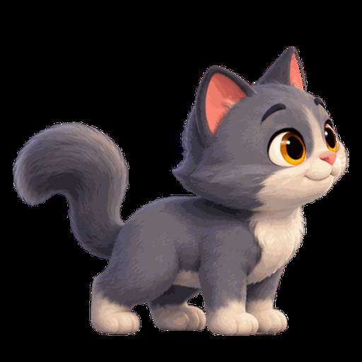

# PetScape

Small autonomous pets for your macOS desktop. They walk along the Dock, jump, climb screen edges,
rest, react to your cursor and, with your permission, explore window tops or dance to music.
PetScape lives in the menu bar and lets clicks outside the pets pass through to your work.

<p align="center"></p>

## Download and install

For **Apple silicon and Intel Macs running macOS 14 or later**. Open **Terminal** and paste this
entire block. It downloads the installer and its checksum, verifies the file and opens the disk
image automatically. No manual file download, Xcode, Git, Python or project checkout is needed.

```bash
mkdir -p "$HOME/Downloads/PetScape-1.0.3" &&
cd "$HOME/Downloads/PetScape-1.0.3" &&
curl --fail --location --proto '=https' --proto-redir '=https' \
  --output PetScape-1.0.3-13-universal.dmg \
  https://github.com/danielcbdev/petscape/releases/download/v1.0.3/PetScape-1.0.3-13-universal.dmg &&
curl --fail --location --proto '=https' --proto-redir '=https' \
  --output PetScape-1.0.3-13-universal.dmg.sha256 \
  https://github.com/danielcbdev/petscape/releases/download/v1.0.3/PetScape-1.0.3-13-universal.dmg.sha256 &&
shasum -a 256 -c PetScape-1.0.3-13-universal.dmg.sha256 &&
open PetScape-1.0.3-13-universal.dmg
```

The last line runs only after the checksum reports `OK`. A failed download or checksum stops the
sequence before the disk image opens.

1. Quit an older running PetScape, then drag **PetScape.app** onto **Applications** in the opened
   disk image. Confirm replacement for an upgrade; back up preferences and installed packs first.
2. Eject **PetScape 1.0.3** in Finder and open **Applications → PetScape**.
3. Look for the **paw icon in the menu bar**; there is no Dock icon. Open **Settings…** there.
   If macOS shows Apple's verification warning, follow the first-open steps below.

`INSTALL-FIRST.txt` in the disk image opens in TextEdit. See the full
[English and Brazilian Portuguese installation guide](docs/development/install.md).
The [release page](https://github.com/danielcbdev/petscape/releases/tag/v1.0.3) also lists the ZIP,
release notes and checksums. SHA-256 detects accidental corruption; it does not independently
authenticate the source when package and checksum are replaced together.

### First open: Apple's verification warning

PetScape is **ad-hoc signed and not notarized**. The message **“Apple could not verify
PetScape.app is free of malware”** (in Portuguese, **“A Apple não pôde verificar se o item
PetScape.app está livre de algum malware”**) is a possible first-open warning for this distribution.
Signature/checksum verification does not replace Apple's notarization or a malware assessment.

If you independently trust the official download and accept the risk:

1. Try opening **PetScape from Applications** once, then dismiss the warning.
2. Open **System Settings → Privacy & Security**, scroll to **Security**, and look for the PetScape
   message with **Open Anyway**. In Portuguese: **Ajustes do Sistema → Privacidade e Segurança →
   Abrir Mesmo Assim**.
3. Click that button, authenticate if asked, then confirm **Open / Abrir** in the next dialog.
4. Look for the paw icon in the menu bar. This approval is specific to the app.

This is your explicit security exception, not Apple verification. Follow
[Apple's current instructions](https://support.apple.com/en-us/102445); older Control-click → Open
instructions do not apply consistently across macOS versions.
If macOS reports malware/damage or the option is unavailable, stop and consult the project owner or
your administrator. Availability depends on OS version and device policy.

## Features

- A native menu bar app with transparent, non-activating pet overlays.
- Autonomous walking, jumping, climbing, resting, expressions and dancing.
- Multiple active characters, one pet per unique character pack, with independent movement,
  animation, behavior and timing. The current bundled character is the cat; additional characters
  come from locally installed packs.
- Native Settings with separate Pets, Behavior, Appearance, Interaction and General sections.
- Per-pet Dance, Stop Dance and Remove controls; shared size, speed and behavior preferences.
- Local character-pack installation from manifest-and-PNG folders, validated before copying.
- English and Brazilian Portuguese interface, following your Mac's preferred languages.
- Simulation/rendering stop while paused, hidden or suspended by system conditions such as sleep,
  screen lock or a full-screen Space.
- Swift 6, SwiftUI, AppKit and Core Animation, with no third-party application dependencies.
- Local operation: no backend, accounts, payments, network requests or telemetry.

## Requirements

| Use | Requirement |
|---|---|
| Run PetScape | macOS 14 or later; Apple silicon is the primary supported architecture |
| Automatic music detection | macOS 14.2 or later and optional system audio consent |
| Build from source | Xcode 26+ with Swift 6.2+ and the Xcode command-line tools |
| Build release DMG/ZIP packages | macOS/Xcode, `python3` standard library and built-in signing/archive tools |

Local development and M21 packaging were verified on macOS 27.0.1 with Xcode 27.1 / Swift 6.4.
The published packages were built on GitHub's macOS 26.6.2 runner with Xcode 26.2 / Swift 6.2.3.
Release DMG/ZIP packages are **universal**, containing arm64 and x86_64 executables. Both slices
are built and signature-verified; native Intel execution and clean macOS 14–26 installation remain
unverified. A paid Apple Developer Program account is not required for the current ad-hoc build path.

## Build and run from source (development)

Select a full Xcode installation as the active developer directory, then clone and run:

```bash
git clone https://github.com/danielcbdev/petscape.git
cd petscape
make run
```

Alternatively, open `PetScape.xcodeproj`, select the shared `PetScape` scheme and run it in Xcode.
There is no package-manager bootstrap step. See [development setup](docs/development/setup.md)
for toolchain selection, signing settings and build details.

Look for the **paw icon in the menu bar**; PetScape has no Dock icon. Open **Settings…** from that
menu. **Hide Pet / Show Pet** and **Pause / Resume** apply to the active roster and persist across
launches. **Quit PetScape** (⌘Q) exits the app. Clicking or dragging a pet does not intentionally
activate PetScape or take keyboard focus from your current app.

## Settings and everyday use

| Section | Controls |
|---|---|
| **Pets** | Add Character, active-pet Dance/Stop Dance/Remove, character catalog and Install Character Pack… |
| **Behavior** | Autonomous activities, jumping, resting, expressions, optional Dance to music and Restart Music Detection |
| **Appearance** | Shared size/speed and Dock offset adjustment (−40…+40 pt) |
| **Interaction** | Cursor reactions, click/drag interaction and optional window interaction |
| **General** | Pause/hide, Wake Pet, launch at login, language guidance and Restore Defaults |

Pet settings apply immediately. The active roster is restored after relaunch; removing a pet from
it does not uninstall its pack. An intentionally empty roster stays empty. Restore Defaults resets
app settings, disables optional window/music interaction and turns off the login item while
preserving the roster and installed packs.

Manual **Dance** is available for eligible active pets with autonomous activities enabled; it does
not need audio permission. Choose the pet in the menu's Dance/Stop Dance submenu or use its Settings
row. Individual packs may use a still-pose fallback when special artwork is unavailable.

With a hidden Dock or a Dock on the left/right, pets use the screen bottom. If paws appear above
or below the Dock, adjust **Settings → Appearance → Dock offset**. Dock placement uses a public-API
estimate and spans the screen width, rather than the Dock shelf's exact horizontal ends.

The interface follows your Mac's preferred languages, with English fallback. Restart PetScape if a
system language change is not reflected. There is no separate in-app language selector.

## Install a character pack

1. Prepare a local **folder** with a schema-v1 `character.json` at its root and every referenced PNG
   at the manifest-relative path. An archive/ZIP is not an accepted character-pack input.
2. Open **Settings → Pets → Install Character Pack…** and select that folder.
3. After validation and installation finish, use **Add Character** or **Add** in the catalog.
   Installing a pack does not automatically add its pet to the desktop.

Installed packs live at:

```text
~/Library/Application Support/PetScape/Characters/<character-id>
```

Each pack needs a unique manifest ID. Duplicate IDs and overwriting/updating existing packs are
rejected. Invalid or missing packs are omitted from the catalog with status information. To uninstall
a pack, quit PetScape, remove its folder in Finder and relaunch; there is no in-app uninstall action.

See the [animation/manifest schema](docs/specifications/animation-schema.md) and
[import resource/security limits](docs/planning/milestones.md#m19--character-pack-discovery-and-installation)
before authoring a pack. Characters are data, not executable plug-ins.

## Privacy and optional permissions

Basic desktop pets, cursor interaction and manual dancing require no special privacy permission.
Opening Settings alone does not request optional consent.

| Feature | Permission and scope |
|---|---|
| **Interact with windows** | Opt-in Accessibility access to read window geometry; never window titles/contents or control of other apps' windows |
| **Dance to music** | Opt-in System Audio Recording access on macOS 14.2+; sound is analyzed locally in memory, never saved or sent |
| **Launch at login** | Explicit toggle using macOS Login Items; macOS may require approval in System Settings → General → Login Items |

PetScape does not request Screen Recording, microphone, Input Monitoring, Automation or Full Disk
Access. Music recognition classifies system output; it is not a media-player connection and can
miss or misclassify audio. See the [permission flows and evidence limits](docs/specifications/permissions.md).

## Release packages and updates

The [GitHub release](https://github.com/danielcbdev/petscape/releases/latest) contains a universal DMG,
an alternative ZIP, per-format SHA-256 files, `SHA256SUMS` and release notes. The DMG includes the
complete app, Applications shortcut, installation notes and source/art license notices. Both formats
include an internal file inventory; after mounting or extracting, run `shasum -a 256 -c CONTENTS.sha256`
from that folder for an additional integrity check.

Quit PetScape before replacing the app in `/Applications`. Preferences and local character packs
remain in your user account; back them up before upgrading. There is no automatic updater or
migration guarantee for downgrades. An ad-hoc signature change may require reviewing optional OS
permissions or the login item again. See [full installation guidance](docs/development/install.md).

## Development and checks

| Command | Purpose |
|---|---|
| `make build` | Build the Debug app into `build/DerivedData` |
| `make build-release` | Build the optimized universal Release app with strict warnings |
| `make run` | Build and launch the Debug app |
| `make test-core` | Run the Swift package's Core/Platform/Rendering/Runtime tests |
| `make test` | Run package tests, then app/UI tests if the package gate passes |
| `make lint` | Check Swift formatting and module boundaries |
| `make format` | Apply the repository's Swift formatting |
| `python3 -B -m unittest discover -s scripts/tests -v` | Test release input validation and failure boundaries |

XCUITest requires a working macOS Automation Mode session; see [setup](docs/development/setup.md#ui-tests-and-automation-mode).
No product privacy permission should be enabled as a workaround for test setup.

The [v1.0.3 strict release validation](https://github.com/danielcbdev/petscape/actions/runs/40260320801)
passed all canonical gates: two complete rounds of 574 Swift Testing tests (plus two XCTest cases
per round), 7 UI tests, 15 release-tool tests, lint, Debug/universal Release/archive and DMG/ZIP
round-trips. Every gate returned zero; no release failure waiver was used.

The owner gave final visual approval of the existing V8 delivery on 2026-10-25. All 134 image hashes
are pinned and every original pixel assertion runs, transparently reporting the exact 48 accepted
findings as Swift Testing **known issues**. Changed images, unapproved findings and disappeared
expected issues still fail. This is artwork acceptance, not a claim of repaired pixels. The
historical release-only waiver is retired. Older failed reports and tooling notices remain in the
[complete M21 evidence](docs/planning/m21-implementation.md).

## Build a release candidate

The same script drives local and GitHub Actions packaging. From a clean checkout, choose a stable
version and a fresh increasing build number. Add matching or nonempty Unreleased notes to
`CHANGELOG.md` first; for example:

```bash
scripts/release.sh 1.0.4 14
```

It runs the canonical gates, creates a Release archive, validates ad-hoc signing and bundle contents,
creates universal DMG/ZIP packages with notes/install instructions/checksums, mounts/extracts them
and verifies them again.
It writes to ignored `dist/release/PetScape-VERSION-BUILD-universal/` without modifying version configs.
Any failed gate prevents normal packaging. The owner-approved V8 visual baseline is evaluated
inside the tests; `ARTWORK-ACCEPTANCE.json` accompanies the package. The retired
`--allow-known-v8-failure` option is rejected by current policy. The script itself creates no tag
and publishes nothing. Choose a fresh version/build; this example does not publish a new release.

For diagnostic local work with uncommitted edits:

```bash
scripts/release.sh 1.0.4 14 --rehearsal
```

Rehearsal uses `dist/rehearsal/`, may create a ZIP marked **NOT FOR PUBLICATION**, and still returns
nonzero when a gate fails. Existing output directories are never overwritten. This mode does not
waive a failed gate or permit publication.

The [release workflow](.github/workflows/release.yml) is manual and defaults to `publish=false`.
It has no V8 failure-bypass input; the historical release-only exception is retired.
It uses Xcode 26.2 on the standard `macos-26` runner, checks repository visibility before scheduling
macOS, pins actions and retains artifacts/logs for seven days. The optional draft-release job alone
gets write permission and requires an already existing `vVERSION` tag at the selected `main` commit.
It never creates or pushes tags. Initial manual availability requires the workflow on the default
branch. Actual publication and hosted-run evidence are recorded in the release notes and
[M21 record](docs/planning/m21-implementation.md).

See the [release runbook](docs/development/release.md) for prerequisites, visibility/billing policy,
artifact layout, local fallback and owner-controlled publication steps.

## Project structure

```text
PetScape/                         SwiftUI app, menu and Settings
Packages/PetScapeKit/Sources/
  PetScapeCore/                   Pure Swift simulation, behavior, physics and animation
  PetScapePlatform/               macOS adapters, permissions and preferences
  PetScapeRendering/              Core Animation overlays and frame resources
  PetScapeRuntime/                Main-actor orchestration and pet lifecycle
assets/characters/               Original character assets and manifests
scripts/                         Asset tooling and release entry point/tests
docs/                            Product, architecture, specifications, plans and evidence
```

The simulation uses a fixed 60 Hz step; Core Animation displays its snapshots. Platform and
Rendering meet in Runtime and do not import each other. See the
[architecture overview](docs/architecture/overview.md) and [ADRs](docs/decisions/README.md).

## Troubleshooting

- **No pet visible:** check the paw menu's Show Pet/Resume controls, then Settings → Pets for an
  active character or load error. A full-screen Space or system suspension can hide the overlay.
- **Music plays but no dance:** enable autonomy, confirm optional System Audio Recording access,
  and use Settings → Behavior → Restart Music Detection. After suspension, music may need to stop
  and start again. Manual Dance remains independent of audio consent.
- **No window interaction:** enable the optional setting and review Accessibility access; PetScape
  pauses window interaction when permission is missing.
- **A pack is unavailable:** check its manifest, referenced PNGs, unique ID and documented limits;
  restart after external edits or removal.
- **A downloaded app is blocked or its checksum fails:** follow the
  [installation troubleshooting](docs/development/install.md); no warning-free opening is promised.

For logs and reproducible diagnostics, see [debugging](docs/development/debugging.md).
Report bugs through [GitHub Issues](https://github.com/danielcbdev/petscape/issues), including macOS,
architecture, build/version, reproduction steps and relevant logs without private information.

## Documentation and contributing

Start with [AGENTS.md](AGENTS.md), [conventions](docs/development/conventions.md) and
[testing](docs/development/testing.md). Keep changes scoped, add deterministic tests for domain
logic and update relevant documentation. Do not modify original artwork under `assets/`.

| Topic | Reference |
|---|---|
| Product and roadmap | [Vision](docs/product/vision.md), [requirements](docs/product/requirements.md), [roadmap](docs/product/roadmap.md) |
| Plans and status | [Milestones](docs/planning/milestones.md), [tasks](docs/planning/task-breakdown.md), [acceptance criteria](docs/planning/acceptance-criteria.md) |
| Changes | [Changelog](CHANGELOG.md) |
| Distribution and remaining evidence | [Release process](docs/development/release.md), [M21 closeout](docs/planning/m21-implementation.md) |
| Full documentation index | [docs/README.md](docs/README.md) |

## License

Source code is licensed under [MIT](LICENSE). The project owner authorized distributing the bundled
art with PetScape; its rights are reserved and it is **not covered by the MIT license**. See
[ARTWORK-LICENSE.md](ARTWORK-LICENSE.md). Imported packs remain subject to their authors' terms.
