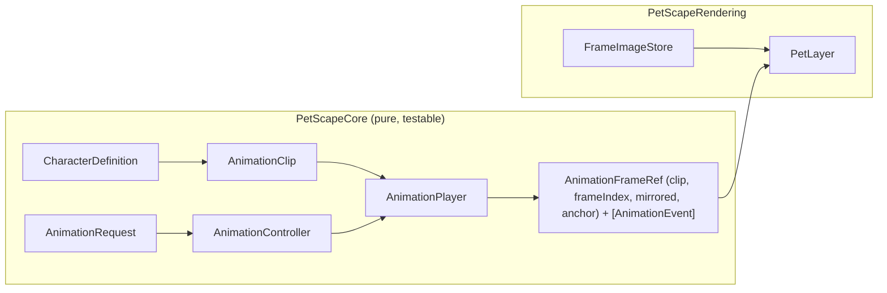

# Animation System

Specs: [animation-schema.md](../specifications/animation-schema.md) (manifest format),
[asset-format.md](../specifications/asset-format.md) (image rules and current asset audit).
Decisions: [ADR-0004](../decisions/0004-spritekit-as-renderer.md),
[ADR-0007](../decisions/0007-character-packs.md).

## Goals

- Any frame count (8, 12, 16, 24, 32, …) and any FPS, declared in data, never in code.
- Animation timing independent of render rate (render 60 fps, walk 9–12 fps).
- Loop, play-once, ping-pong; pause, resume, interrupt; priorities; chained transitions.
- Orientation (mirroring), scale, anchor points, surface alignment, frame events.
- Efficient loading, frame image cache, graceful handling of missing files.
- Independent from behavior logic: behavior asks for "a clip by name"; it never knows frame counts.

## Split of responsibilities

| Type (module) | Responsibility |
|---|---|
| `AnimationClip` (Core) | Immutable, validated clip: frame refs, per-frame durations, playback mode, anchor, alignment, events, `next`, nominal speed |
| `AnimationPlayer` (Core) | Value type. Given `dt`, advances elapsed time and returns the current frame index and any events crossed. No wall clock. |
| `AnimationController` (Core) | Per-pet: holds current player, resolves requests (priority, interruptibility, fallbacks, one-shot `next` chaining) |
| `FrameImageStore` (Rendering) | Decodes, downsamples and caches frame images as `CGImage`; builds hit masks |
| `PetLayer` (Rendering) | Applies `AnimationFrameRef` from the snapshot: layer `contents` (frame image), bounds, anchor, mirroring transform |

### Why not renderer-driven animation (`CAKeyframeAnimation` on `contents`, `SKAction.animate`)

Evaluated and rejected for domain logic:

- Their timing follows the render server/layer clock, not our fixed-step simulation, so
  pause/resume and simulation determinism would diverge.
- Per-frame durations and frame events (`footstep`, `takeoff`) would need callbacks from the
  renderer into domain code (wrong dependency direction).
- They cannot be unit-tested without a running render loop.

The renderer ([ADR-0015](../decisions/0015-core-animation-renderer.md), Core Animation) only
displays the frame chosen by the domain; implicit layer animations are disabled. Core Animation
animations may still be used for purely cosmetic, non-domain effects (e.g. a debug fade).

## Playback model

Time unit: seconds (`Double`). Clip duration = sum of frame durations; a frame's duration is its
own `duration` or `1 / clip.fps`.

| Mode | Behavior at end |
|---|---|
| `loop` | wraps to frame 0; emits `loopCompleted` |
| `once` | holds last frame; emits `finished`; controller then plays `next` if declared |
| `pingPong` | reverses direction at ends (end frames not duplicated); emits `loopCompleted` per round trip |

- **FPS independence:** the player accumulates simulation `dt` and may advance several frames in one
  step (e.g. after a long frame); all crossed frame events are emitted in order. Frame boundaries are
  compared with a 1e-9 s tolerance so a boundary that falls exactly on a step is not missed. Entering
  frame 0 (start/restart) emits its events on the first step. A single step of a repeating clip plays at
  most 16 whole cycles; beyond that, whole cycles are skipped (phase kept, their events dropped).
- **Pause/resume:** the player only advances when stepped; pausing the simulation pauses animation.
- **Playback rate:** `rate` multiplier (e.g. walk speed setting ×1.2 → rate ×1.2) keeps feet in sync.
- **Interruption & priority:** `AnimationRequest(clip, priority, restart)`. `AnimationController`
  accepts a request when the current clip has finished (a `once` clip holding its last frame); else,
  when the current clip is `interruptible: false`, only if `priority >= 90`
  (`AnimationRequest.criticalPriority`); else if `priority >= current.priority`. A "minimum frames"
  rule is not in schema v1 (no field for it). Requesting the playing clip keeps its position unless
  `restart` is set. Priorities are owned by the behavior layer, not the assets
  (see [state-machines.md](../specifications/state-machines.md)).
- **Transitions:** v1 uses hard cuts plus explicit transition clips (`sit-down` then `sit`), chained
  by `next` in data or by the state machine. Cross-fades are out of scope (sprites with alpha
  blending look poor for 2.5D characters).
- **Fallbacks:** requesting a missing clip resolves through the manifest `fallbacks` chain, then the
  character's `defaultAnimation`. Resolution happens once at load time (validated, cycle-free), so
  runtime lookups are O(1).

## Orientation, scale, anchors, alignment

- Clips declare which way they face (`facing`, default from character). If the pet faces the other
  way and the clip is `mirrorable`, the layer uses a `scaleX: -1` affine transform around the anchor; otherwise the clip's `variants`
  provides a dedicated clip.
- Layer bounds are **always** set from the manifest `displaySize × userScale`, never from the
  image's pixel size (`contentsGravity = .resize` scales the frame image into those bounds).
- The anchor is the contact point (e.g. between the paws for walking) in normalized canvas space.
  The pet's world position *is* the contact point, so placing a pet on a surface is trivial.
- `alignment` (`bottom`, `left`, `right`, `top`) says which canvas side touches the surface; the
  renderer rotates/mirrors accordingly (used by climbing in M11).

## Loading, caching, memory

| Concern | Decision |
|---|---|
| Decoding | ImageIO (`CGImageSourceCreateThumbnailAtIndex` with `kCGImageSourceThumbnailMaxPixelSize`) off the main actor; decoded once |
| Target pixel size | `ceil(max(displaySize) × maxBackingScale × maxUserScale)`; MVP: 96 pt × 2 × 1.5 = 288 px |
| Display | The decoded `CGImage` is assigned to `PetLayer.contents`; Core Animation uploads it once and reuses it (no per-frame decoding) |
| Preload | All frames of the clips in use are decoded before the pet is shown (first-frame hitch avoided); assigning each frame once while hidden is evaluated if a hitch is observed |
| Cache key | `(characterID, imagePath, pixelSize)` |
| Eviction | Per character; unloaded when no pet uses that character (multi-character future) |
| Filtering | `.linear` (smooth downscaling of painted art) |
| Hit masks | Built from the same decoded images at reduced resolution (see [asset-format.md](../specifications/asset-format.md)) |

Memory math (RGBA8, decoded):

| Source | Per frame | 8 frames | 20 clips × 24 frames |
|---|---|---|---|
| 512 × 512 (current source) | 1.0 MiB | 8 MiB | 480 MiB ❌ |
| 288 × 288 (downsampled) | 324 KiB | 2.5 MiB | 152 MiB ⚠️ |
| 192 × 192 (96 pt @2x, scale ≤ 1) | 144 KiB | 1.1 MiB | 68 MiB ✅ |

Conclusion: downsampling at load is mandatory; with large future clip libraries, clips should load
lazily per behavior family (M14 task) or be authored at the target size.

Xcode asset catalogs / sprite atlases were considered. They give build-time packing but cannot
load user-provided packs at runtime and hide frame metadata from the manifest, so they are not the
primary path (see ADR-0007). PoC E7 also showed that a runtime atlas does not change memory use.

## Error handling

| Failure | Behavior |
|---|---|
| Manifest missing/invalid JSON/unsupported schema | Character fails to load → placeholder sprite, menu shows error, log `.error` |
| A frame image missing/undecodable | Clip marked invalid → its fallback is used; log `.error` with path |
| Default clip invalid | Character fails to load (as above) |
| Inconsistent frame canvas sizes | Load continues; log `.fault` in DEBUG / `.error` in release |
| Image memory budget exceeded | Downsample further, log `.error` |

The placeholder is a programmatically drawn silhouette so the app remains usable and the failure
is visible.

## How to add a new animation (summary)

1. Export PNG frames (see [asset-format.md](../specifications/asset-format.md)) into
   `assets/characters/<id>/<clip>/frames/`.
2. Add the clip to `assets/characters/<id>/character.json` (fps or per-frame durations, playback,
   anchor if different, events, fallbacks).
3. Run the manifest validation test target (`make test` → `CharacterManifestTests` validate every
   bundled pack).
4. Reference the clip name from a behavior state (only if new behavior is needed; replacing art
   for an existing clip needs no code).
