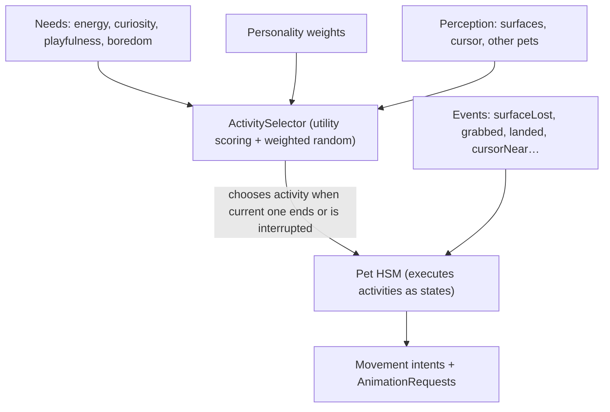

# Behavior Engine

Decision: [ADR-0006](../decisions/0006-behavior-model.md). State tables:
[state-machines.md](../specifications/state-machines.md).

## Approaches evaluated

| Approach | Strengths | Weaknesses for PetScape |
|---|---|---|
| Flat FSM | Simple, explicit, testable | State explosion once sleeping/airborne/dragged combine |
| **Hierarchical FSM (HSM)** | Explicit states + shared parent handling (e.g. any `Grounded` state reacts to "surface lost") | Requires discipline in transition tables |
| Behavior Trees | Great for complex, reactive AI with many sequences | Overkill for one pet with ~15 states; ticking trees every step costs CPU; harder to reason about "what state is the cat in?" for animation |
| **Utility AI** | Natural, personality-driven choices ("tired cat looks for a place to sleep") | Needs a layer that executes the chosen activity reliably |
| LLM | — | Explicitly forbidden; nondeterministic, costly |

## Decision: two layers



1. **Execution layer — HSM** (MVP onwards). Owns *what the pet is doing now*. Deterministic given
   events. Every state maps to an animation request and a motion mode.
2. **Decision layer — `ActivitySelector`** (M9). When an activity ends (or a cooldown expires),
   scores candidate activities and picks one by weighted random. It never touches motion directly.

MVP uses only the execution layer with two states (`walking`, `turning`) — no needs, no selector.

## Needs and personality (M9)

- Needs are `0…1` values that drift over simulated time (energy decreases while active and recovers
  while sleeping; boredom rises while repeating; curiosity spikes with stimuli like cursor movement).
- Personality is static per character (manifest or code defaults): `curiosity`, `playfulness`,
  `laziness`, `sociability` in `0…1`. The cat: curious 0.8, playful 0.7, lazy 0.6.

Activity score (initial formula, tunable):

```text
score(a) = baseWeight(a)
         × personalityFactor(a)            // e.g. sleep × (0.5 + laziness)
         × needFactor(a, needs)            // e.g. sleep × (1 − energy)²
         × availability(a, perception)     // 0 if prerequisites missing (no surface to sit on)
         × cooldownFactor(a, now)          // 0 during cooldown, ramps back to 1
         × noveltyFactor(a, history)       // penalize repeating the same activity
```

Choice: weighted random over the top-k scores (k = 3) using the injected `RandomSource`; ties and
zero-sum cases fall back to `idle`.

## Priorities and interruptions

Events are handled by priority; a higher-priority event interrupts the current activity:

| Priority | Source | Examples |
|---|---|---|
| 100 | User | grabbed, released (M10) |
| 90 | Safety | surface lost, out of bounds, invalid state |
| 80 | Physics | landed, edge reached |
| 50 | Stimuli | cursor near, startled, other pet near (future) |
| 10 | Activity selection | chosen activity (walk, sit, sleep, …) |

Some states declare `minimumDuration` (e.g. `sit-down` cannot be interrupted by stimuli before it
finishes), but priority ≥ 90 always interrupts.

## Cooldowns, probabilities, timing

- Cooldowns per activity (e.g. `stretch`: 120 s after completion).
- Durations are ranges sampled from `RandomSource` (e.g. `sleep` 60–300 s).
- All times are simulation time, so pausing does not let timers expire.

## Testability

- `RandomSource` is injected; tests use `SeededRandomSource(seed:)` or a scripted source returning
  a fixed sequence.
- Simulation time is driven by tests (`world.step(dt:)` loops), no real sleeping.
- Tests assert on state sequences and emitted events, e.g. "a tired lazy cat chooses sleep within
  N decisions with seed S" and "surface lost interrupts sleep".

## Recovery from invalid states

Each state has a `maxDuration` (stuck detection). Unknown/invalid combinations (e.g. `walking`
without attachment) transition to a recovery state (`falling` or respawn) and emit
`recovered(reason)`. Recovery is logged and visible in the debug overlay.
