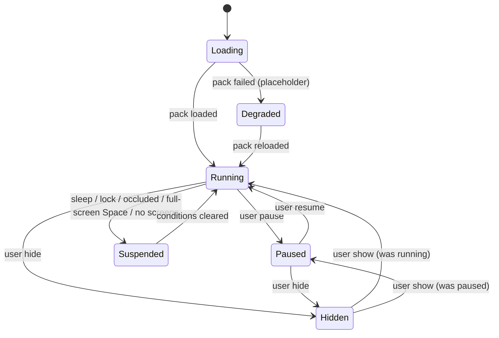
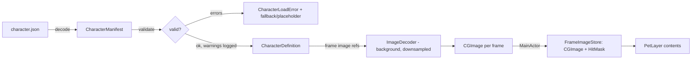

# Data Flow

## Current pipeline (M9 working tree)

Platform notifications execute on MainActor, synchronously **between world steps**.
OverlayCoordinator applies screens/Dock/host overlays, then calls PetRuntime.onScreensChange;
PetRuntime applies world screens/surfaces and renders immediately. There is no implemented pending
input queue. Core stepping is synchronous, so these callbacks cannot mutate it mid-step.

```mermaid
sequenceDiagram
  participant ENV as Platform callback (MainActor)
  participant OC as OverlayCoordinator
  participant RT as PetRuntime
  participant W as PetWorld
  participant R as PetRenderer / PetHitTester
  ENV->>OC: screens or system condition
  OC->>RT: onScreensChange / onStatusChange
  RT->>W: apply screens, then surfaces (between steps)
  OC->>RT: onFrame(CADisplayLink.timestamp)
  loop fixed 60 Hz steps (0..5 moving; up to 120 sleeping)
    RT->>W: step(dt: 1/60, into: events)
  end
  RT->>W: writeSnapshot(into:)
  RT->>R: same snapshot → layers and masks
  RT->>OC: update needsFrames
  OC->>OC: cursor sample → pass-through
```

Values crossing module boundaries are Sendable. Rendering never mutates the world; Core never
calls platform APIs. Snapshot caches/layer positions are presentation state only. The single frame
source is DisplayLinkFrameDriver, not a SpriteKit scene or a second simulation scheduler.

## Implemented runtime integration

Keep this callback/frame pipeline. Compose host floor + Dock before applying surfaces. World owns
all position commits (motion and explicit environment/lifecycle corrections). Within a fixed step:
reconcile safety/contact → intention/state timers → physics/sweep → commit body/contact → physical
phase/events → animation request/advance → validate. Contact chooses Landing art in that same step;
asset markers never determine force or contact. Full rules: [Physics Engine](physics-engine.md),
[Jump System](jump-system.md).

After final snapshot, render and update hit masks before cursor pass-through. Drive existing
needsFrames from `world.needsSimulationSteps || world.needsAnimationFrames`, **independently of
snapshot visibility**. Existing RunStatus permission still dominates. Reset accumulator whenever
effective frames stop/start or host driver is replaced; first callback seeds time. Reconcile latest
screens/surfaces on resume before any physical step. No event queue/new scheduler is required.

When permission is running but demand is false (held Idle), effective driver is paused;
coordinator keeps event-driven cursor monitoring while visible and unoccluded. RunStatus permission alone does not imply an effective running driver; OverlayCoordinator uses its
effective driver transition callback to reset time and enable monitoring without simulation polling. User pause/suspension remains
unchanged. Interpolation is deferred; any future interpolated snapshot must match hit masks and
flush prior state on reprojection/recovery, never draw through a changed Dock.

## Event sources and how they enter

| Source | Adapter | Delivery | Becomes |
|---|---|---|---|
| Display config, resolution, scaling | `ScreenProvider` (`NSApplication.didChangeScreenParametersNotification`) | MainActor callback between steps | `[ScreenDescriptor]`, overlay re-layout |
| Dock size/position/autohide | `DockSurfaceProvider` (recomputed on screen-parameter changes) | MainActor callback between steps | `Surface` (kind `.dockTop` or `.screenBottom`) |
| Cursor | `CursorSampler` | Sampled per frame; global mouse-moved monitor wakes pass-through while sim is stopped | `WorldInput.cursor` (M10), pass-through hit test |
| Mouse on pet (click/drag) | `OverlayPanel` / `OverlayContentView` mouse events | AppKit events while pass-through is disabled | `PetEvent.grabbed/dragged/released` (M10) |
| Sleep/wake, lock, display sleep | `SystemEventsMonitor` (`NSWorkspace` notifications) | Notification | `RunState.suspended` on/off |
| Overlay occlusion | `OverlayWindowManager` (`NSWindow.didChangeOcclusionStateNotification` on its panels) | Notification | `RunState.suspended` on/off |
| Full-screen Space | `FullScreenSpaceDetector` (`activeSpaceDidChange` → `CGWindowList` read twice) | Notification + delayed reads | `RunState.suspended` on/off |
| User intents | Menu / Settings via `AppModel` | Direct method call | `RunState`, preferences |
| Other apps' windows | `WindowTracker` (M12) | AX notifications / throttled refresh | `Surface` (kind `.windowTop`) with stable IDs |

## Run state

The diagram includes conceptual loading/error presentation; actual RunState enum cases are
running/paused/hidden/suspended. M7/M8 reuse them without introducing Recovering as a runtime state.



- `Running` is the only implemented RunState granting permission for the frame driver to run. It runs while a visible pet animates or an
  unplaced pet needs a recovery/placement step on an available surface (`OverlayCoordinator.needsFrames`, set
  by `PetRuntime`); before the character loads or without a surface, it stays paused. Preferred rate: 60 Hz
  (ProMotion displays are capped at the simulation rate; the MVP cat always walks, so no lower idle rate is used
  yet). `Degraded` is descriptive load-result terminology (LoadedCharacter.failure / AppModel status),
  not an implemented RunState enum case; placeholder follows the same permission/demand rules.
- `Paused`: sprites visible, frame driver stopped (display link `isPaused = true`), no timers.
- `Hidden`: overlays ordered out; frame driver stopped.
- `Suspended`: system-driven; never persisted. User intent (pause/hide) is persisted (FR-18).
  `Suspended` only overlays `Running`; a paused or hidden pet stays paused/hidden through sleep.
- On resume, the accumulator is reset so the pet does not "catch up" on elapsed wall time.
- Overlay visibility is derived separately from the state (`RunStatus.resolve`, Core): ordered out while
  hidden or while any system reason except occlusion holds (sleep, display sleep, session inactive, lock,
  full-screen Space, no screens) — so a *paused* pet also disappears in a full-screen Space. Occlusion only
  stops frames: ordering out because of it would keep the overlay occluded forever.
- The global mouse-moved monitor runs only while the overlay is visible, not occluded and without frames
  (i.e. paused).

## Asset loading flow



Specification: [animation-schema.md](../specifications/animation-schema.md),
[asset-format.md](../specifications/asset-format.md).

## M9 passive sleep timing and Settings

Production `PetRuntime` reads `PreferencesStore.petSettings` before spawning: it configures autonomy
and speed on the world and spawns at the persisted display scale. A plain `PetWorld` remains
explicit-command only; legacy runtime tests deliberately supply an autonomy-disabled preference.
`setPetSettings(_:)` applies scale, speed and behavior between steps, persists them and redraws
immediately, including while paused/hidden. Core owns geometry/plan revalidation. `wakePet()` is an
explicit intent and resets frame timing. The renderer/hit masks always consume the same snapshot.

Held fallback sleep still has logical deadlines and needs: it requests 4 Hz (the display driver's
minimum range may deliver 2 Hz). Authored sleep requests at most its clip FPS. While all pets are
sleeping, the same accumulator accepts at most 2 seconds / 120 fixed ticks per callback. The ordinary
moving policy stays at 5 ticks / 0.25 seconds. A passive batch stops on its first state transition,
dropping remaining ticks rather than advancing wake/fall/movement in a burst. Support changes are
applied synchronously between callbacks; the first safety tick leaves sleep and restores normal
frame demand. Pause/hide/suspension/driver replacement/settings changes reset the accumulator;
the next callback only seeds its timestamp. No timer or additional scheduler is added. DEBUG frame-rate evidence counts completed world steps,
including a zero-step callback sample, rather than the passive accumulator's possibly truncated budget.

`SettingsModel` is MainActor/Observable in Runtime and imports no SwiftUI. Native App controls only
forward intents. Menu pause/hide labels read this same model's current intent, including after
Restore Defaults. The DEBUG Dock controls use that same SettingsModel and read its offset directly;
relative adjustments start from Runtime's current offset, so interleaving Settings, Debug and restore
cannot reuse a stale cached value. `AppContainer` owns preferences, runtime and model lifetimes. It observes app
activation to refresh login status, removes the observer in `stop()`, and Settings also refreshes
on appearance. There is no polling.

## Persistence

`PreferencesStore` is a MainActor seam with UserDefaults and in-memory implementations. Version 2
adds `petscape.scale` (0.5–1.5, default 1), `petscape.speed` (0.5–2, default 1), and boolean keys
`petscape.autonomy`, `petscape.jumps`, `petscape.rest`, `petscape.expressions` (default true).
`PetSettings` normalizes nonfinite size/speed to 1 and clamps finite values on read/write.

Existing `petscape.isPaused`, `petscape.isHidden` and `petscape.dockOffsetAdjustment` (±40 points,
default 0) retain their meanings. Migration records `petscape.preferencesVersion = 2` only when
the stored version is older. Absent new keys provide defaults, preserving v1 choices without
rewriting them. Future versions are never downgraded. Restore Defaults removes only this version's
known value keys, retaining the version, unknown future keys and unrelated defaults; it never
removes a domain. In-memory restoration has the same user-visible result.

Login state is deliberately not persisted: Platform's `LaunchAtLoginService` returns actual enabled,
disabled, requires-approval or not-found state. `SystemLaunchAtLoginService` wraps public
`SMAppService.mainApp`; only explicit Settings toggles or Restore Defaults call register/unregister.
Restore also unregisters a pending approval registration. Typed `LaunchAtLoginError` remains visible
on failure while status is reread from the service; no optimistic success state is shown. Startup,
opening Settings and activation only read state. Real registration behavior needs manual verification
with a signed installed app; automated tests use an injected service and never mutate OS login items.

DEBUG UI tests launch with `--settings-test-suite PetScapeUITests.<UUID>`. This selects both a unique
UserDefaults suite and a fake login service (initially enabled to exercise restore). A failed suite
allocation stays in memory; it never falls back to owner preferences. Test teardown terminates the
app and removes only that suite. Release builds have neither launch-argument selection nor fake.
