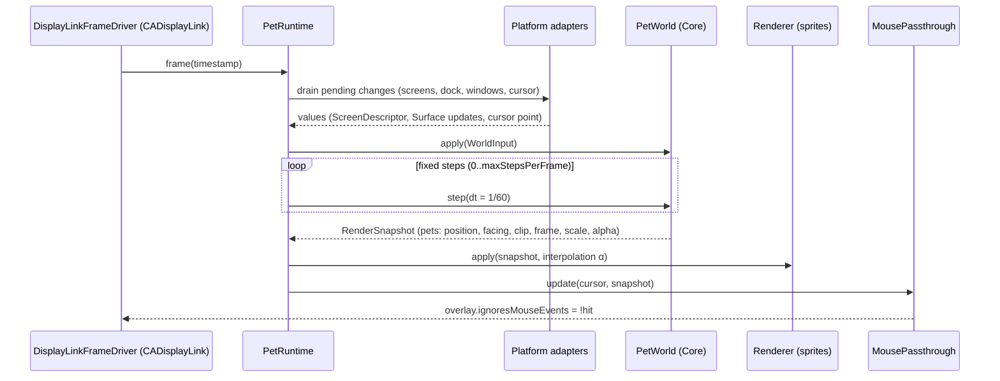
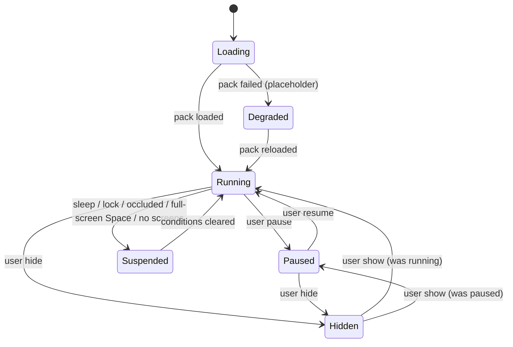
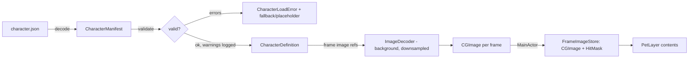

# Data Flow

## Per-frame pipeline

Rules:

- **One direction.** Platform → Runtime → Core → snapshot → Rendering. Rendering never mutates
  the world; Core never calls out.
- **Values across boundaries.** Everything that crosses a module boundary is a `Sendable` value
  (`ScreenDescriptor`, `Surface`, `RenderSnapshot`). No AppKit or Core Animation types in Core APIs.
- **Events are batched.** Notifications (screen change, Dock change, window moved) are converted
  to values and queued; they are applied at the start of the next frame, never mid-step.
- **Snapshots are complete.** The renderer can draw from a snapshot alone; it holds no domain state
  apart from caches (frame images, layers keyed by `PetID`).

## Event sources and how they enter

| Source | Adapter | Delivery | Becomes |
|---|---|---|---|
| Display config, resolution, scaling | `ScreenProvider` (`NSApplication.didChangeScreenParametersNotification`) | Notification → queue | `[ScreenDescriptor]`, overlay re-layout |
| Dock size/position/autohide | `DockGeometryProvider` (recomputed on screen-parameter changes) | Notification → queue | `Surface` (kind `.dockTop` or `.screenBottom`) |
| Cursor | `CursorSampler` | Sampled per frame; global mouse-moved monitor wakes pass-through while sim is stopped | `WorldInput.cursor` (M10), pass-through hit test |
| Mouse on pet (click/drag) | `OverlayPanel` / `OverlayContentView` mouse events | AppKit events while pass-through is disabled | `PetEvent.grabbed/dragged/released` (M10) |
| Sleep/wake, lock, display sleep | `SystemEventsMonitor` (`NSWorkspace` notifications) | Notification | `RunState.suspended` on/off |
| Overlay occlusion | `OverlayWindowManager` (`NSWindow.didChangeOcclusionStateNotification` on its panels) | Notification | `RunState.suspended` on/off |
| Full-screen Space | `FullScreenSpaceDetector` (`activeSpaceDidChange` → `CGWindowList` read twice) | Notification + delayed reads | `RunState.suspended` on/off |
| User intents | Menu / Settings via `AppModel` | Direct method call | `RunState`, preferences |
| Other apps' windows | `WindowTracker` (M12) | AX notifications / throttled refresh | `Surface` (kind `.windowTop`) with stable IDs |

## Run state

- `Running` is the only state in which the frame driver runs, and only while a pet is placed on a surface
  (`OverlayCoordinator.needsFrames`, set by `PetRuntime`): before the character loads or without a surface
  nothing changes on screen, so the display link stays paused. Preferred rate: 60 Hz (ProMotion displays are
  capped at the simulation rate; the MVP cat always walks, so no lower idle rate is used yet). `Degraded` behaves like `Running`
  but renders a placeholder and shows an error in the menu.
- `Paused`: sprites visible, frame driver stopped (display link `isPaused = true`), no timers.
- `Hidden`: overlays ordered out; frame driver stopped.
- `Suspended`: system-driven; never persisted. User intent (pause/hide) is persisted (FR-18).
  `Suspended` only overlays `Running`; a paused or hidden pet stays paused/hidden through sleep.
- On resume, the accumulator is reset so the pet does not "catch up" on elapsed wall time.
- Overlay visibility is derived separately from the state (`RunStatus.resolve`, Core): ordered out while
  hidden or while any system reason except occlusion holds (sleep, display sleep, session inactive, lock,
  full-screen Space, no screens) — so a *paused* pet also disappears in a full-screen Space. Occlusion only
  stops frames: ordering out because of it would keep the overlay occluded forever.
- The global mouse-moved monitor runs only while the overlay is visible, not occluded and without frames
  (i.e. paused).

## Asset loading flow

Specification: [animation-schema.md](../specifications/animation-schema.md),
[asset-format.md](../specifications/asset-format.md).

## Persistence

`UserDefaults` via `PreferencesStore` (protocol). Keys are namespaced (`petscape.`) and versioned
(`petscape.preferencesVersion`, currently 1). MVP keys: `petscape.isPaused` (Bool) and `petscape.isHidden`
(Bool) since M5; `petscape.dockOffsetAdjustment` (Double, points, clamped to −40…+40, absent = 0) since M6,
added without a version bump because its absence means the default. No other persistence in the MVP.
Pause/hide are read once at launch to seed `RunStateController` and written whenever the user changes them.
