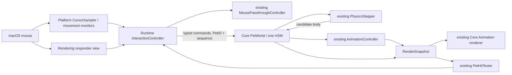

# M10 interaction architecture

Status: **M10 implementation in progress — 2026-10-18.** Cursor sample/button contracts, local/global
movement monitors, 10 Hz active cursor evaluation, v3 settings, interaction controller/world authority,
click reaction, held/drop lifecycle, cancellation hooks and Reduce Motion input are implemented with
automated coverage. Native event routing remains inconclusive; V5 production and full quality gates remain
open. The task plan is
[M10](../planning/m10-implementation.md); behavioral contracts are in
[interaction.md](../specifications/interaction.md). This document owns the code inventory and
platform strategy; it does not supersede accepted ADRs.

## Diagnosis and compatibility

The repository already implements the input adapter, event forwarding, alpha hit testing,
pass-through latch, fixed-step world, physics, HSM, recovery and animation required as foundations.
M10 extends those seams. There is no separate MovementController class: `PetWorld` interprets
`MovementIntent`, calls `PhysicsStepper`, and commits the resulting body.
`PetRuntime` now reduces primary-button events through `InteractionController`; `.dragged` updates the
same world-owned session. Its existing `.dragging` pass-through state means capture of a mouse
sequence, while `PetState.held` and `PetWorld` own physical dragging. The underlying WindowServer
delivery/click-through behavior has not been proven by native POC trials.

The brief's SpriteKit references conflict with accepted ADR-0015, actual imports and `make lint`.
Retain Core Animation, `CADisplayLink`, `AnimationPlayer`, and `CoordinateConverter`.
There is no SpriteKit coordinate space or SKAction in the proposed implementation. Existing
M9 acceptance and its real-login/native-sleep/installed-playtest evidence gaps remain unchanged.
FR-24 approach/startle and FR-25 throwing remain historical broader requirements; this planning
revision scopes the first delivery to bounded observation, click, pickup and zero-impulse release.
Their IDs are retained with explicit scope notes in the requirements/task registers.

## Inspected components

Paths below are relative to `Packages/PetScapeKit/Sources/` unless they begin `PetScape/` or
`assets/`. Bare filenames after a qualified path use that directory; a repeated `Layers/` suffix
uses the same PetScapeRendering module. **Every resolved path in this table exists at the inspected HEAD.**
Core values are nonisolated,
Sendable, executed serially by Runtime on MainActor. Platform, Rendering and Runtime use package
default MainActor isolation. No new background event processing is proposed.

| Existing file | Responsibility / dependencies and contract | Mutable state / owner | Extension / risk |
|---|---|---|---|
| `PetScapePlatform/Input/CursorSampler.swift` | `NSEvent.mouseLocation`, pressed buttons and uptime → `CursorSample`; injectable `GlobalMouseMonitoring` | monitor token / MainActor | Add exact primary-button state and local/global movement lifecycle; current any-button Bool cannot detect primary-up while secondary held |
| `PetScapeRuntime/Overlay/OverlayCoordinator.swift` | Screens, Dock, RunState, Rendering panels, driver; `onFrame` before mask sampling; owns platform lifecycle | screens/host/converter/driver/effective demand / MainActor | Add sample hook and cancellation **before** panel replacement/hide; current screen callback happens after panels can close |
| `PetScapeRuntime/Passthrough/MousePassthroughController.swift` | `PetHitTesting` + `CursorSample` → window-wide ignores flag; never acquire an already-held external drag | passThrough/interactive/dragging, sample time / MainActor | Retain sole pass-through writer, add sequence-ID capture and explicit reset; current down does not re-hit-test and any-up inference is too broad |
| `PetScapeRuntime/Passthrough/PetHitTesting.swift` and `PetHitTester+PetHitTesting.swift` | Boolean Runtime seam adapted to Rendering | no independent body / MainActor | Extend seam with `petID(at:)` (keep contains convenience); test fakes need migration |
| `PetScapeRendering/Overlay/OverlayPanel.swift` | Full host-screen nonactivating NSPanel, level Dock−1, no key/main | AppKit frame, visibility, ignores flag / MainActor | Preserve configuration; physical capture currently covers entire panel whenever enabled |
| `PetScapeRendering/Overlay/OverlayContentView.swift` | Layer host, activeAlways tracking, first mouse, down/drag/up/move forwarding | tracking areas/callback/layers / MainActor | Add typed primary metadata, do not interpret behaviors; returning nil from view hitTest cannot redirect WindowServer routing |
| `PetScapeRendering/Overlay/OverlayMouseEvent.swift` | Sendable kind/location/uptime | value / MainActor producer | Append button identity; use event-time window location converted to canonical points, rather than today's latest cursor position for old queued events |
| `PetScapeRendering/Overlay/OverlayWindowManager.swift` | Panel map, occlusion observers, global pass-through setting | panels/observer tokens/visibility / MainActor | Candidate small input panel lives here, never Platform; lifecycle and z-order changes require PoC/ADR approval |
| `PetScapeRendering/HitTesting/PetHitTester.swift` | Snapshot→reused entry buffer, current frame `HitMask`; `petID(at:)` returns topmost | entries / MainActor | Already supports target IDs, mirroring, scale and visible airborne pets; invalidate stale snapshots on hide/replacement |
| `PetScapeRendering/Images/HitMask.swift` | Load-time derived alpha≥128, 4×4 cells, one-cell dilation | immutable Sendable cells | Reuse, no GPU readback/per-event image decode; coarse dilation is an existing tolerance, not pixel-perfect |
| `PetScapeRendering/Layers/PetRenderer.swift` and `Layers/PetLayer.swift` | Snapshot→CALayer/image, manifest display size and anchor | layer map / MainActor | No input/position authority; held must become visible in snapshots |
| `PetScapeCore/Geometry/CoordinateConverter.swift` | Global/Quartz/overlay and normalized mask conversions | screen value snapshot / Runtime rebuild | Add named window-local conversion only if small panel needs it; negative origin and Retina tests |
| `PetScapeCore/Pets/Pet.swift` | Sole persisted-in-memory body: foot `position`, velocity, attachment; needs/traits/activity/animation | world-owned value | Add reservation/session/held-target bookkeeping; no Runtime copy of body position |
| `PetScapeCore/World/PetWorld.swift` | apply inputs between steps; HSM, needs, physics, commit, placement/recovery and demand | pets/surfaces/time/random/events / MainActor caller | Central M10 ownership seam; exhaustive switches, reservation safety, held demand/visibility must all change together |
| `PetScapeCore/World/WorldInput.swift` and `WorldEvent.swift` | Sendable typed environment/commands and facts | value/event buffers | Add interaction commands/events; assess all exhaustive consumers including Runtime log |
| `PetScapeCore/Physics/MovementIntent.swift`, `PhysicsStepper.swift`, `ContactGeometry.swift`, `PhysicsTuning.swift` | Pure hold/walk/airborne candidates, sweep, stable logical support width; gravity 2400, terminal 1800, watchdog 3 s | value inputs/results; world tuning | Reuse fall/landing after release. Held bypasses airborne integration/watchdog; do not reset watchdog continuously while falling |
| `PetScapeCore/Surfaces/SurfaceMap.swift` and `PetScapePlatform/Dock/DockSurfaceProvider.swift` | Host floor+estimated full-width Dock; existing first-hit sweep and notification-fed changes | map/world; estimate/MainActor | No real Dock icon/shelf shape known; no window surfaces or inter-display handoff in M10 |
| `PetScapeCore/Behavior/PetState.swift`, `GroundedState.swift`, `ActivitySelector.swift`, `Personality.swift`, `Needs.swift` | One grounded/airborne hierarchy, deadline choices, seeded traits/energy | per-pet activity/deadlines/cooldowns / world | Add held and bounded reaction phases; do not feed cursor into a second selector or reinterpret numeric art thresholds as operational priorities |
| `PetScapeCore/Animation/AnimationController.swift`, `AnimationPlayer.swift` | Simulation dt and semantic requests; critical entry, optional fallbacks | player/priority/requested clip / world | New requests hold safe fallback if semantic art missing; never infer release/contact from frame events |
| `PetScapeCore/Characters/CharacterManifest.swift`, `CharacterDefinition.swift` and `assets/characters/cat/character.json` | Schema v1, validated resolution, optional traits; 512 px canvas, 96 pt display, anchor (0.5,0.074), six actual clips | definitions immutable; file read at load | No schema migration needed; new names use hyphens, not requested underscore spellings |
| `PetScapeRuntime/FrameDriver/DisplayLinkFrameDriver.swift` and `PetScapeCore/Time/FixedStepAccumulator.swift` | One display link, fixed 1/60 step, bounded backlog and special passive sleep accounting | driver/accumulator / MainActor | Held/pressed need 60 Hz guard; disallow passive sleep catch-up while reserved; no timer or second display link |
| `PetScapeRuntime/RunState/RunStateController.swift`, `PetScapePlatform/SystemEvents/SystemEventsMonitor.swift` | User/system gates, notification lifecycle | intent/reasons/observer tokens / MainActor | Cancel ownership before gate/teardown; paused pointer monitor may route only, never step |
| `PetScapeRuntime/PetRuntime/PetRuntime.swift` | Owns world, rendering, events, frame demand and Settings application | world/snapshot/accumulator / MainActor | Integrate one InteractionController and validated command acknowledgement; current callbacks alone do not implement interaction |
| `PetScapeCore/Pets/PetSettings.swift`, `PetScapePlatform/Preferences/PreferencesStore.swift`, `UserDefaultsPreferencesStore.swift`, `InMemoryPreferencesStore.swift` | Clamped Sendable Settings, version 2 namespaced persistence | defaults/in-memory store / MainActor | Optional InteractionSettings value; v3 preserves v1/v2 intent, current/future keys |
| `PetScapeRuntime/Settings/SettingsModel.swift` and `PetScape/SettingsView.swift` | Observable intent forwarding, native controls | model/store/runtime / MainActor | Two toggles, live cancel before size/setting changes, UI must remain usable on short screens |
| `PetScapeCore/Diagnostics/Log.swift` and `Signposts.swift` | OSLog categories and frame/step/render intervals | immutable loggers / callers | Reuse overlay/behavior/physics categories; transition/count/duration only, remove cursor-coordinate DEBUG traces in touched handlers |

Tests already exist under `Packages/PetScapeKit/Tests/`: `PetScapePlatformTests/CursorSamplerTests.swift`,
`PreferencesStoreTests.swift`, `PetScapeRuntimeTests/MousePassthroughControllerTests.swift`,
`PetRuntime/PetRuntimeTests.swift`, `Settings/SettingsModelTests.swift`,
`PetScapeRenderingTests/HitTesting/PetHitTesterTests.swift`, `Images/HitMaskTests.swift`,
`OverlayPanelTests.swift`, `OverlayWindowManagerTests.swift`, `PetScapeCoreTests/World/PhysicsWorldTests.swift`,
`JumpWorldTests.swift`, `JumpAnimationTests.swift`, `Behavior/AutonomyTests.swift` and geometry tests.
Native UI tests are `PetScapeUITests/PetScapeLaunchTests.swift` and `PetScapeSettingsTests.swift`.
They test existing contracts; none proves M10.

## Cursor APIs and proposed observation policy

| Mechanism | Coverage / permissions | Cost, latency and lifecycle | Verdict |
|---|---|---|---|
| `NSEvent.mouseLocation` | Global current screen point; existing permission-free API | Synchronous cheap read, no notifications or wakeup source itself; staleness determined by caller | Reuse one read per existing frame, plus on transitions |
| View responder/tracking area | Own receiving window only; no permission | Event-driven, low local latency; ignored panels cannot provide desktop-wide awareness | Direct sequence and own-overlay movement |
| Local mouse monitor | Only this process, runs before normal dispatch; no permission | Returns original event unchanged, main thread, remove token on stop | Covers Settings/own windows while global monitor cannot |
| Global mouse monitor | Asynchronous copies for **other** apps; cannot consume, rewrite or retarget | Mouse-move only; no keyboard masks. Native permission-free delivery must be rechecked in PoC; event volume depends on input hardware | Update route immediately and cache latest sample; not an input interceptor |
| Repeating timer query | Global sampling but independent wakeups | Polls stationary pointer, competes with display link and sleep | Reject |
| `CGEventTap` | Different security/permission semantics, process-wide event stream | More complex and unnecessary; may require forbidden privileges | Reject, not a fallback |

Propose a mouse-only local+global movement bridge while a pet is visible/unoccluded and direct
interaction is enabled, even when display frames exist. This closes the existing moving-cursor
sampling gap at 4 Hz sleep, but **does not guarantee zero routing races**. Route/mask gating runs
immediately on each movement callback; no timer/throttle there. Existing frame callback also
rechecks against the newest mask, essential for a moving pet under a stationary cursor.
When only awareness is enabled, reuse frame samples; no extra monitor for awareness alone.
Local callback returns its original event exactly once; do not double-handle down/up through a
local monitor and responder. Global monitor failure disables direct acquisition and shows a
Settings status; it does not trigger a permission request. Awareness can continue from frames.

Behavioral interpretation consumes latest position at **10 Hz active**, **2 Hz sleeping** (no
sleep interruption), **0 Hz paused/hidden/suspended**, using timestamps from existing callbacks.
Native down/drag/up and primary-button recovery are processed immediately; pressed/held frame
work uses **60 Hz**, with only the latest drag move kept for the next fixed step. No unbounded
movement queue, interpolation or position filtering. Paused visible legacy routing remains
event-driven and never initiates M10 commands. Hidden/suspended: remove monitors/tracking as
applicable, clear cache, zero interaction work. Resume seeds timestamps, no elapsed catch-up.

## Selective event routing and focus

`ignoresMouseEvents` controls the entire NSWindow; a clear CALayer is not an OS input region.
WindowServer chooses a target before AppKit dispatch. A global observer cannot change that choice;
`hitTest` returning nil can affect routing inside our process, not resend a missed click to another
application. Rechecking at down prevents a false cat action but cannot undo swallowing that click.
Never synthesize/repost a click into another app to compensate.

| Candidate | Benefit | Limitation / disposition |
|---|---|---|
| Existing full-screen overlay + dynamic toggle | No new window, already has historical PoC evidence, cheap static window | Enabled window can swallow unrelated events on stale geometry/fast exit; keeps entire-screen capture through sequence. Compare in PoC, not automatically sufficient for M10 |
| Resize existing render panel around cat | Limits rectangle with one panel | Every movement changes frame and layer origin; replaces established screen-coordinate assumption and display source; higher rendering regression risk |
| **Static render overlay always ignores mouse + one small nonactivating input panel** | Limits physical capture to current pet canvas, preserves renderer/driver; reuse coarse alpha gate | New panel move cost/occlusion lifecycle; transparent holes still need toggle; no atomic guarantee on event races. **Preferred candidate, conditional on PoC and owner approval** |
| Bounding rectangle alone / view hitTest / window alpha | Simple | Cannot satisfy transparent region requirement; reject |

Do not add the small panel in this planning execution. Test the existing strategy first, then
compare the preferred bounded candidate with the same exact gesture matrix. If candidate passes,
ADR-0020 amends ADR-0003's input topology only after owner acceptance. If neither passes, keep
M10 direct interaction gated, record the failure and propose a revised ADR; no silent weakening
of NFR-04. Awareness is independently viable. A small panel **reduces** possible interception;
it does not prove alpha holes click through.

Candidate panel uses the same `.borderless/.nonactivatingPanel`, no key/main, first-mouse policy,
AX exclusion, collection behavior and Dock−1 level. It spans the current manifest canvas
`spriteRect`, no screen-wide expansion even in a drag. The render panel is permanently
`ignoresMouseEvents = true`; the existing MousePassthroughController exclusively sets the input
panel's flag. Canvas is based on authoritative snapshots. No duplicate cat layer, world or driver.
Panel is ordered above our render panel, below Dock. Dock may obscure the cat and must retain
click/scroll/drag/magnification/auto-hide priority; this is not real shelf geometry detection.

The accepted primary down latches pet ID + sequence ID, follows AppKit responder drag/up even
outside panel bounds **[validate]**, and releases capture on up/cancel. Preserve nonactivation
style from construction; never change it dynamically or call activate/makeKey/orderFront with
activation. Settings is an explicit normal activation path, not an overlay-click effect.
Do not promise focus preservation until the new native matrix passes with a foreground text editor.

## Proposed allocation of new responsibilities

- Runtime `InteractionController` owns target acquisition, pure gesture reducer, sequence IDs,
  monotonic input timing, current latest sample, and pass-through/world acknowledgement ordering.
  It sends typed commands into PetWorld and observes outcomes. It has **no pet position field**.
- Core `InteractionSession` is a small Sendable gesture value (available/hover/pressed/dragging),
  used by Runtime; it stores down point, grab offset, pet/sequence IDs and latest pointer only.
  It does not run autonomous choice or physics. World validates every command independently.
- Core `PetWorld` owns a press reservation, held target, phase entry, body commits and release;
  `PetState.held` is the single physical held phase. Falling/landing/recovery remain existing HSM
  phases. RunState still gates all simulated time.
- Rendering optionally owns the native input panel/view inside OverlayWindowManager; mouse samples
  remain Platform values and meet Rendering only in Runtime. No Platform↔Rendering import.

## Primary sources and evidence boundary

Consulted 2026-10-18. API semantics are documented; PetScape's proposed native topology remains untested.

- [Apple: mouseLocation](https://developer.apple.com/documentation/appkit/nsevent/mouselocation) — screen-coordinate sample independent of pending events.
- [Apple: event monitoring](https://developer.apple.com/library/archive/documentation/Cocoa/Conceptual/EventOverview/MonitoringEvents/MonitoringEvents.html) — local/global scopes, main-thread callbacks, monitor removal and key-event privilege distinction.
- [Apple: global monitor](https://developer.apple.com/documentation/appkit/nsevent/addglobalmonitorforevents%28matching%3Ahandler%3A%29) — asynchronous observation cannot change delivery.
- [Apple: NSWindow](https://developer.apple.com/documentation/appkit/nswindow) — window-wide ignores flag and native event routing API.
- [Apple: nonactivatingPanel](https://developer.apple.com/documentation/appkit/nswindow/stylemask-swift.struct/nonactivatingpanel) — owning app activation policy.
- [Apple: event architecture](https://developer.apple.com/library/archive/documentation/Cocoa/Conceptual/EventOverview/EventArchitecture/EventArchitecture.html) — down target and usual drag/up responder continuity.
- [Apple: handling mouse events](https://developer.apple.com/library/archive/documentation/Cocoa/Conceptual/EventOverview/HandlingMouseEvents/HandlingMouseEvents.html) — event-driven down/drag/up approach.

No documentation citation is evidence of successful current-macOS focus, Dock routing, small-panel
continuity or latency. Historic M1/M3 observations are supporting prior evidence, not M10 PoC results.
