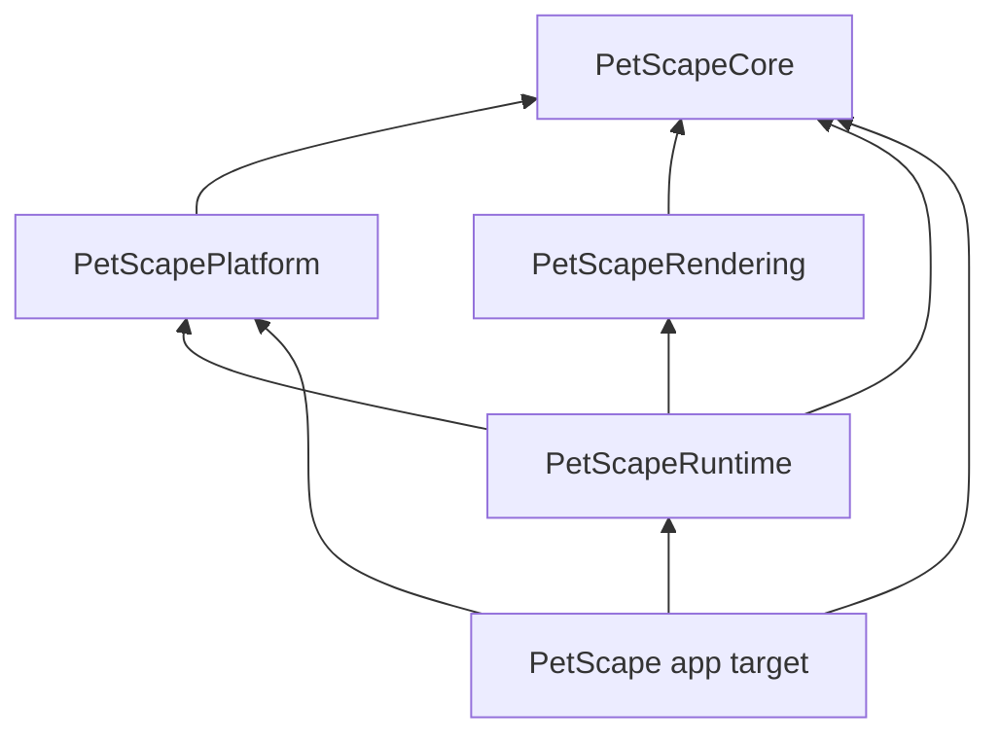

# Modules

Decision record: [ADR-0002](../decisions/0002-project-structure.md).

## Repository layout (target state after M2)

```text
petscape/
├── AGENTS.md / CLAUDE.md / CODEX.md      # agent instructions (AGENTS.md is canonical)
├── README.md
├── Makefile                               # canonical build/test/lint entry points (M2)
├── .swift-format                          # formatter/linter config (M2)
├── Config/                                # xcconfig files: Base, Debug, Release, bundle ID (M2)
├── PetScape.xcodeproj                     # app target + UI tests only (M2)
├── PetScape/                              # app target sources (SwiftUI shell)
│   ├── App/                               # PetScapeApp, AppDelegate, AppContainer
│   ├── MenuBar/
│   ├── Settings/                          # (M9)
│   └── Resources/                         # Info.plist, Assets.xcassets, Localizable.xcstrings
├── PetScapeUITests/
├── Packages/PetScapeKit/
│   ├── Package.swift
│   ├── Sources/
│   │   ├── PetScapeCore/
│   │   ├── PetScapePlatform/
│   │   ├── PetScapeRendering/
│   │   └── PetScapeRuntime/
│   └── Tests/
│       ├── PetScapeCoreTests/
│       ├── PetScapePlatformTests/
│       ├── PetScapeRenderingTests/
│       └── PetScapeRuntimeTests/
├── assets/                                # source art (originals are read-only) + character packs
├── docs/
└── scripts/                               # small shell helpers (only when needed)
```

## Dependency graph



No cycles. `Platform` and `Rendering` never depend on each other; they meet only in `Runtime`.

## Module responsibilities

### PetScapeCore — the domain (pure Swift)

Imports: Foundation, `os`. No UI frameworks. Most types are `Sendable` value types. Default actor
isolation: **nonisolated**.

| Folder | Contents |
|---|---|
| `Geometry/` | `Segment`, geometry helpers on Foundation's `CGPoint`/`CGRect`/`CGVector`, `ScreenDescriptor`, `CoordinateConverter` (AppKit global ↔ Quartz global ↔ scene; see [coordinate-system.md](../specifications/coordinate-system.md)) |
| `Time/` | `SimulationTime`, `FixedStepAccumulator`, `Clock` protocol + `ManualClock` for tests |
| `Random/` | `RandomSource` protocol, `SeededRandomSource` (SplitMix64) |
| `Characters/` | `CharacterManifest` (Codable, schema v1), `ManifestValidator`, `CharacterDefinition` (validated, resolved model) |
| `Animation/` | `AnimationClip`, `AnimationPlayer` (time → frame index, events), `AnimationRequest`, fallback resolution |
| `Pets/` | `PetID`, `Pet` (state container), `Facing`, `Personality`, `Needs` |
| `Surfaces/` | `Surface`, `SurfaceID`, `SurfaceKind`, `SurfaceMap` (queries), `DockGeometryEstimator` (pure heuristic) |
| `Physics/` | `KinematicBody`, `PhysicsStepper`, `JumpSolver` (M8) |
| `Behavior/` | `PetState` (HSM), `PetEvent`, `TransitionTable`, `ActivitySelector` (M9) |
| `World/` | `PetWorld` (owns pets + surface map, `step(dt:)`), `WorldInput` (cursor, environment changes), `RenderSnapshot` |
| `Diagnostics/` | `Log` categories (thin wrappers over `os.Logger`) |

### PetScapePlatform — macOS environment adapters

Imports: Core, AppKit, CoreGraphics, ApplicationServices, ServiceManagement. Default isolation:
**MainActor**. Adapters are thin: they read the system and convert to Core values; heuristics
live in Core so they can be tested.

| Folder | Contents |
|---|---|
| `Screens/` | `ScreenProvider` (NSScreen → `ScreenDescriptor`, change notifications) |
| `Dock/` | `DockGeometryProvider` (feeds `DockGeometryEstimator` with screen data + optional Dock prefs hints) |
| `Input/` | `CursorSampler` (`NSEvent.mouseLocation`, global mouse-moved monitor) |
| `SystemEvents/` | `SystemEventsMonitor` (sleep/wake, screens sleep, session resign/become active, lock) |
| `Preferences/` | `PreferencesStore` protocol + `UserDefaultsPreferencesStore` |
| `Permissions/` | `AccessibilityPermission` (M12) |
| `WindowTracking/` | `WindowTracker` protocol + implementations (M12) |
| `LoginItem/` | `LoginItemController` via `SMAppService` (M9) |

### PetScapeRendering — Core Animation renderer and overlay windows

Decision: [ADR-0015](../decisions/0015-core-animation-renderer.md). Imports: Core, AppKit, QuartzCore, ImageIO. Default isolation: **MainActor**, except the image
decoding service, which is explicitly `nonisolated`/`@concurrent`.

| Folder | Contents |
|---|---|
| `Overlay/` | `OverlayPanel` (NSPanel subclass), `OverlayContentView` (layer-backed, non-flipped `NSView`; receives mouse events while interactive), `OverlayWindowManager` (one per screen) |
| `Layers/` | `PetLayer` (one `CALayer` per pet: frame image, size, anchor, mirroring; implicit animations disabled), `DebugOverlayLayer` (`CAShapeLayer`s, DEBUG only) |
| `Images/` | `ImageDecoder` (ImageIO, downsampling), `FrameImageStore` (decoded `CGImage` cache), `HitMask` (alpha mask) |
| `HitTesting/` | `PetHitTester` (global point → pet ID using masks) |

### PetScapeRuntime — orchestration

Imports: Core, Platform, Rendering, AppKit. Default isolation: **MainActor**.

| Type | Role |
|---|---|
| `PetRuntime` | Owns `PetWorld`; applies run state (running/paused/hidden/suspended); bridges platform events into world inputs; pushes snapshots to renderer |
| `FrameDriver` | Protocol for "call me each display frame"; `DisplayLinkFrameDriver` wraps the overlay view's `CADisplayLink` (pause, preferred frame rate) |
| `MousePassthroughController` | Decides `ignoresMouseEvents` per overlay from hit tests |
| `RunStateController` | Combines user intent (pause/hide) with system state (sleep, lock, occlusion) |
| `CharacterLoader` | Loads manifest + frame images for a pack, reports errors |

### App target — SwiftUI shell and composition root

`PetScapeApp`, `AppDelegate`, `AppContainer`, `MenuBarContent`, (M9) `SettingsView`. Contains no
domain logic; views talk to a small `@Observable` `AppModel` that forwards intents to `PetRuntime`.

## When to split or merge modules

- Split `PetScapeCore` only when a sub-area needs a different dependency set or compile times
  become a problem (measure first). Candidate: `PetScapeBehavior` once utility AI grows.
- Do not create a module per "engine". Engines are folders inside Core with clear type boundaries.
- Any new module requires an ADR update.
