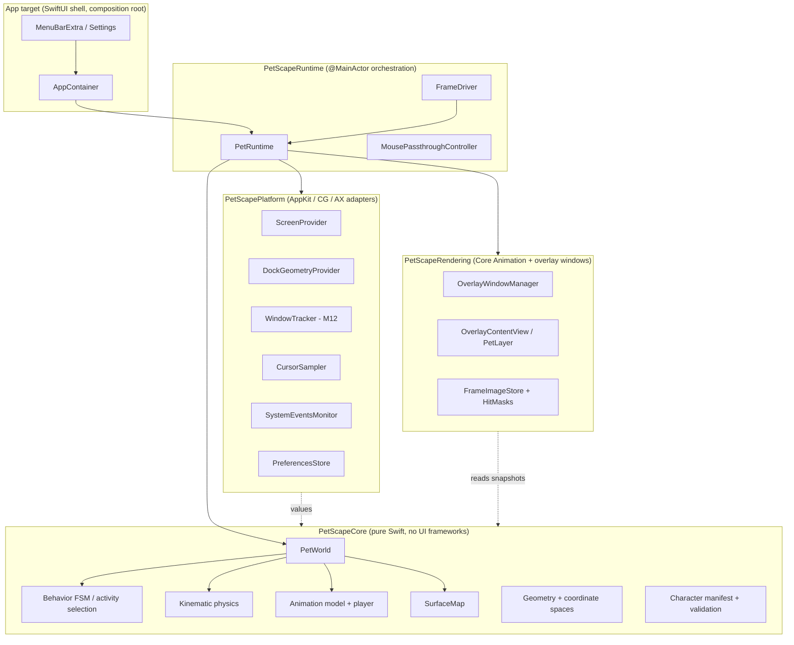

# Architecture Overview

Status: **Proposed** (pending owner approval and PoC results; see
[proof-of-concept.md](../planning/proof-of-concept.md)).

## Shape of the system

PetScape is a menu bar app that runs a small **simulation** (pets, surfaces, behavior, physics,
animation timing) and **projects** it onto transparent overlay windows rendered with Core Animation.

The central idea: **the simulation is pure Swift and knows nothing about AppKit or Core Animation.**
Platform adapters feed it facts about the desktop (screens, Dock, windows, cursor) as plain values;
the renderer draws snapshots of it. This keeps the hard logic deterministic and unit-testable and
lets infrastructure be replaced (e.g. a different renderer or window-tracking strategy) without
touching domain rules.

## Architectural style

| Style evaluated | Verdict |
|---|---|
| Full Clean Architecture (entities / use cases / interface adapters / frameworks, one protocol per boundary) | Too much ceremony for a single-process app with ~4 boundaries; would multiply protocols without adding safety |
| Domain / Application / Infrastructure layering | **Adopted in spirit:** `PetScapeCore` = domain + application rules (pure), `PetScapePlatform` and `PetScapeRendering` = infrastructure adapters, `PetScapeRuntime` = application orchestration, app target = composition root |
| MVVM/MVC everywhere | Only for the SwiftUI shell (`@Observable` models); the simulation is not UI-driven |
| Protocol-oriented programming | Used at real seams (platform adapters, clock, randomness, frame driver, hit testing), not for every type |
| Dependency injection | Initializer injection, composed in one `AppContainer`; no container framework, no singletons |

The one rule taken from Clean Architecture without compromise: **dependencies point inward** to the
pure core, enforced by module boundaries.

## Layering rules

| Layer | May import | Must not import |
|---|---|---|
| `PetScapeCore` | Foundation, CoreGraphics (geometry value types), `os` (logging) | AppKit, SwiftUI, QuartzCore, ApplicationServices, any other PetScape module |
| `PetScapePlatform` | Core, AppKit, CoreGraphics, ApplicationServices (AX), ServiceManagement | QuartzCore layers, SwiftUI, Rendering, Runtime |
| `PetScapeRendering` | Core, AppKit, QuartzCore, ImageIO | Platform, Runtime, SwiftUI, SpriteKit |
| `PetScapeRuntime` | Core, Platform, Rendering, AppKit | SwiftUI |
| App target | everything above, SwiftUI | — (but contains no domain logic) |

These rules are enforced by Swift Package target dependencies, not just convention. Details and
rationale: [modules.md](modules.md), [ADR-0002](../decisions/0002-project-structure.md).

## Key decisions (summary)

| Topic | Decision | ADR |
|---|---|---|
| Platform | macOS 14+, Swift 6 language mode, Apple silicon primary | [0001](../decisions/0001-platform-baseline.md) |
| Structure | Xcode app target + one local Swift package with 4 library targets | [0002](../decisions/0002-project-structure.md) |
| Overlay | One borderless, non-activating, transparent `NSPanel` per screen; mouse pass-through by default, enabled only over pet pixels | [0003](../decisions/0003-overlay-window-strategy.md) |
| Rendering | Core Animation (`CALayer` per pet, `CADisplayLink`) renders snapshots only; SpriteKit rejected after PoC E7 (~5× memory, ~5× CPU) | [0015](../decisions/0015-core-animation-renderer.md) (supersedes [0004](../decisions/0004-spritekit-as-renderer.md)) |
| Physics | Custom kinematic "platformer" controller, fixed timestep | [0005](../decisions/0005-kinematic-physics.md) |
| Behavior | Hierarchical FSM for actions + utility-based activity selection (post-MVP) | [0006](../decisions/0006-behavior-model.md) |
| Assets | Data-driven character packs (JSON manifest + PNG frames) | [0007](../decisions/0007-character-packs.md) |
| Coordinates | One canonical global space (AppKit global points, y-up); conversions centralized | [0008](../decisions/0008-coordinate-system.md) |
| Dock | Public-API heuristics (`visibleFrame`) + manual offset; no private APIs | [0009](../decisions/0009-dock-geometry.md) |
| Distribution | Developer ID + notarization, Hardened Runtime, **no App Sandbox** | [0010](../decisions/0010-distribution-no-sandbox.md) |
| Tooling | No third-party dependencies; Swift Testing; bundled `swift-format` | [0011](../decisions/0011-tooling-and-dependencies.md) |
| Concurrency | `@MainActor` for simulation/render/AppKit; `Sendable` value types in Core; off-main only for asset decoding | [0012](../decisions/0012-concurrency-model.md) |
| Simulation loop | Fixed 60 Hz step with accumulator, driven by a `CADisplayLink`; render rate adaptive | [0013](../decisions/0013-simulation-loop.md), amended by [0015](../decisions/0015-core-animation-renderer.md) |
| AI agents | `AGENTS.md` is the single source of truth; tool-specific files are thin | [0014](../decisions/0014-ai-agent-instructions.md) |

## Runtime lifecycle (MVP)

1. `PetScapeApp` (SwiftUI `App`) starts with `LSUIElement = YES`; `AppDelegate` builds the
   `AppContainer` (composition root).
2. The container loads preferences, builds the `ScreenProvider`, `DockGeometryProvider`,
   `FrameImageStore`, `OverlayWindowManager` and `PetRuntime`.
3. `PetRuntime` loads the cat character pack (manifest decode + validation and image decoding off
   the main actor, layer setup on the main actor), spawns the pet on the Dock surface and
   starts the frame driver (display link).
4. Each frame: drain platform events → fixed-step simulation → build render snapshot → update sprites →
   update mouse pass-through.
5. Pause / hide / sleep / lock / occlusion stop the frame driver entirely (no rendering, no timers).
6. Quit: stop driver, remove observers, close overlays, flush preferences.

Data flow details: [data-flow.md](data-flow.md).

## Where to read next

- Modules and dependencies: [modules.md](modules.md)
- Per-subsystem design: [animation-system.md](animation-system.md), [pet-engine.md](pet-engine.md),
  [physics-engine.md](physics-engine.md), [behavior-engine.md](behavior-engine.md),
  [macos-integration.md](macos-integration.md), [window-tracking.md](window-tracking.md)
- Risks and open questions: [risks.md](../planning/risks.md)
