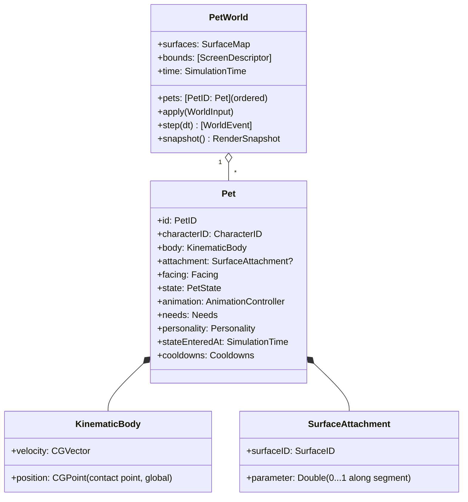
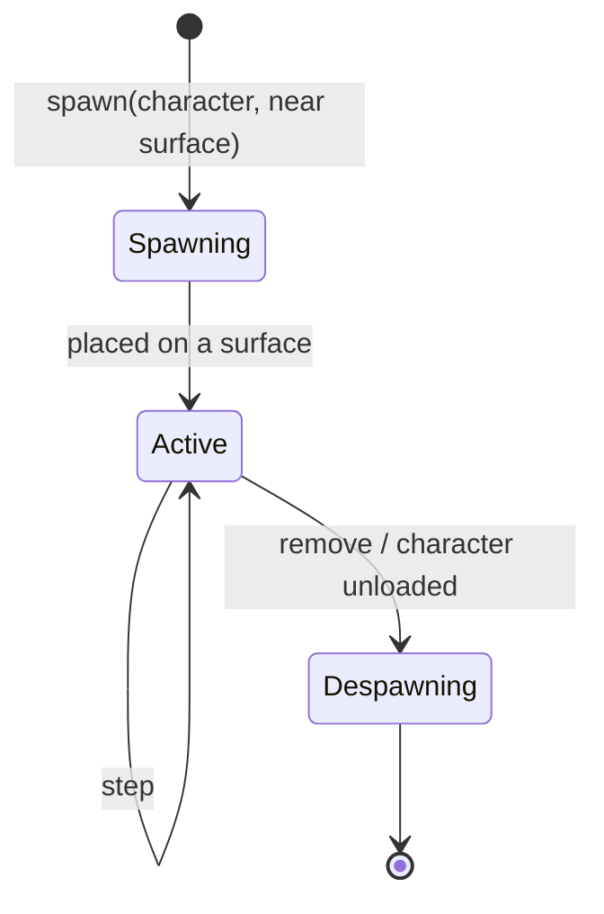

# Pet Engine

The pet engine is the core simulation in `PetScapeCore/World`, `Pets`, plus the systems it calls
(behavior, physics, animation, surfaces). It has **no dependency on SwiftUI, AppKit or Core Animation**.

## Responsibilities

Identity, position, orientation, velocity, state, current surface, current animation, personality,
events, lifecycle — for every pet in a `PetWorld`.

## Model options evaluated

| Option | Pros | Cons | Verdict |
|---|---|---|---|
| Entity Component System | Scales to thousands of entities; data-oriented | Heavy for 1–5 pets; indirection obscures logic; no first-party Swift ECS outside GameplayKit | Rejected |
| GameplayKit (`GKEntity`/`GKComponent`, `GKStateMachine`) | First-party, integrates with SpriteKit | Class-based, reference semantics, not `Sendable`; hard to snapshot and test deterministically; ties domain to an Apple game framework | Rejected |
| Class hierarchy (`Cat: Pet`) | Familiar | New characters need code; fragile base class | Rejected |
| **Value-type composition** (struct `Pet` composed of small structs; systems as functions over `PetWorld`) | Deterministic, snapshot-able, `Sendable`, trivial to test, characters as data | Needs discipline to keep systems separate | **Chosen** |

## Data model

- `PetWorld` is a `struct`. `step` is `mutating` and returns the `WorldEvent`s produced in the step.
- `CharacterDefinition`s are immutable, shared, and looked up by `CharacterID` from a
  `CharacterRegistry` passed into the world (no globals).
- Position is the **contact point** in the canonical global space
  ([coordinate-system.md](../specifications/coordinate-system.md)).

## Step order

Each fixed step (`dt = 1/60 s`) runs systems in a fixed order, which keeps behavior deterministic:

1. **Environment apply** – surface updates queued since last step (moved/removed surfaces re-project
   attached pets or detach them).
2. **Perception** – build a read-only `Perception` per pet (nearby surfaces, cursor, other pets as values).
3. **Behavior** – state machine reacts to events/perception; may request animation and movement intents.
4. **Physics** – integrate the kinematic body according to state (walk along surface, fall, jump, climb).
5. **Surface resolution** – landings, edge reached, surface lost → emit events for next step.
6. **Animation** – advance `AnimationController`; collect frame events (e.g. `footstep`, `apex`).
7. **Validation** – invariants (finite numbers, inside some screen, attachment valid); recovery if violated.

## Lifecycle

Spawn chooses the best surface (MVP: Dock top / screen bottom of the Dock's screen), places the pet
at a random parameter, random facing.

## Events

Typed, not stringly: `enum WorldEvent { case stateChanged(PetID, from: PetStateKind, to: PetStateKind), surfaceLost(PetID), landed(PetID, SurfaceID), animationEvent(PetID, AnimationEvent), recovered(PetID, reason: RecoveryReason) … }`.
Used for logging, debug overlays and tests; future pet interactions consume them via perception.

## Preparing for multiple pets (not in MVP)

- Pets are stored in an ordered collection keyed by `PetID`; all systems already iterate.
- Pets never hold references to each other. Interactions go through `Perception.otherPets`
  (values) and typed intents (`.approach(PetID)`, `.chase(PetID)`), resolved by the world.
- Rendering keys nodes by `PetID`; hit testing returns a `PetID`.
- Adding a character = adding a character pack + optional personality defaults; no engine change.

## Invariants and recovery

| Invariant | Recovery |
|---|---|
| Position/velocity finite (no NaN/∞) | Reset to last valid state, `recovered(.invalidNumbers)` |
| Position within the union of screen frames (with margin) | Respawn on nearest valid surface |
| Attached surface exists | Detach → falling (M7+) or respawn (MVP) |
| State has a valid animation | Resolve fallback / default clip |
| State duration below a per-state max (stuck detection) | Force transition to idle/walk |
