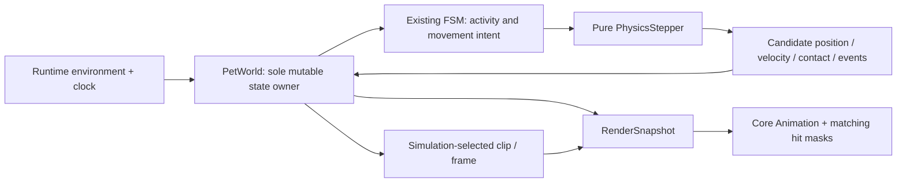

# Pet Engine

Current implementation includes the M20 active roster; historical M7–M9 decisions and acceptance
records remain in their milestone documents. M20 details are in the [implementation record](../planning/m20-implementation.md).

## Implemented model

PetWorld is a Sendable struct, mutated by PetRuntime on MainActor. It contains an ordered `[Pet]`,
SurfaceMap, screens, `time: Double`, BehaviorTuning and an injected RandomSource used to seed each
new pet's independent random stream. Needs, Personality and activity bookkeeping are Sendable pet
values; ActivitySelector is a pure weighted selection system. There is no dictionary registry or
separate KinematicBody.

Pet contains identity, `position: CGPoint` (canonical global foot contact), optional
SurfaceAttachment(surfaceID, parameter), Facing, PetState, stateElapsed, AnimationController and
world-owned scale, velocity, simulated airborne/cooldown counters, immutable pending jump plan,
walk/idle return intent, energy/personality and the current activity/deadline/cooldowns. CharacterDefinition is reached through the animation controller. `Pet.size`
comes from definition.displaySize × scale, not decoded image pixels.

Current APIs include spawn(definition, scale:), removePet(PetID), apply(WorldInput), step(dt:into:),
and writeSnapshot(into:). A stable character ID can appear at most once in one world.
Settings/wake inputs are configureBehavior, setDisplayScale, setSpeedScale and wake. A default
PetWorld remains explicit-command only; production PetRuntime restores enabled autonomy by default.
Environment inputs are complete screens/surfaces, applied as surface diffs; same-ID surfaces
reproject attachments. PetState refines grounded/airborne phases; ordinary support loss falls visibly, while exceptional
invalid/host-loss states reuse recovering/spawning/resettle/place. Rendering never mutates world state.
Snapshot fields include isVisible/isAnimating independently: valid airborne pets remain visible.

## Implemented M7/M8 ownership

Pet.position and velocity are world-owned; PetState declares physical phases. SurfaceAttachment remains the only contact
reference; there is no independent body position or stored ContactState. PhysicsStepper is a pure
system in Core; Runtime commands recovery/environment through WorldInput and never assigns pet
coordinates itself. Geometry and step contracts live in [Physics Engine](physics-engine.md).

World step order: reconcile environment/invariants → existing FSM/intention → physics candidate and
swept contact → single world commit → physical events/phase transition → animation selection and
advance → final validation. Runtime publishes one final snapshot after fixed steps; the same result
feeds rendering/hit testing. Frame demand is explicit for physical/timed/pending work independently
of visible art. See [Data Flow](data-flow.md) for operational ordering.

M7 Grounded/Airborne handles fall/land; M8 adds Idle, preparation/rising and an immutable jump plan
with return intent; M11 adds Grounded climbing on the same `PetState` hierarchy and
`SurfaceAttachment`. [Jump System](jump-system.md) owns phase
transitions, cancellation and solver. M9 adds rest/expression phases and boundary-only weighted
choices within that same hierarchy. [Behavior Engine](behavior-engine.md) owns energy, eligibility,
durations, cooldowns and held fallback poses. No second FSM or scheduler is added.

## Lifecycle, invariants and recovery

Existing place/resettle/reproject methods stay the only lifecycle/environment correction mechanisms.
M7 ordinary support removal detaches in place and falls visibly; adding Dock cannot teleport a
floor pet. Invalid numbers, host loss and out-of-bounds use bounded exceptional placement. No
usable surface means pending spawn waiting for an environment event, no recurring retry/timer.

Every position/velocity is finite, grounded attachment exists/supports the pet, airborne attachment
is nil, and the foot stays in the hosted screen plus existing margin. Animation always resolves to
a playable clip/default/placeholder. Airborne watchdog and phase durations use simulated time,
which freezes on pause/hide/suspension. Full recovery policy/test limits are owned by Physics Engine.

Each pet owns independent state, animation, placement, interaction, deadlines and random sequence.
Runtime and rendering resources are keyed by PetID; pets never hold references to other pets.
Shared preferences and environmental signals remain global and are routed to each eligible pet.
Do not add ECS, GameplayKit, subclasses or new modules for M20.
