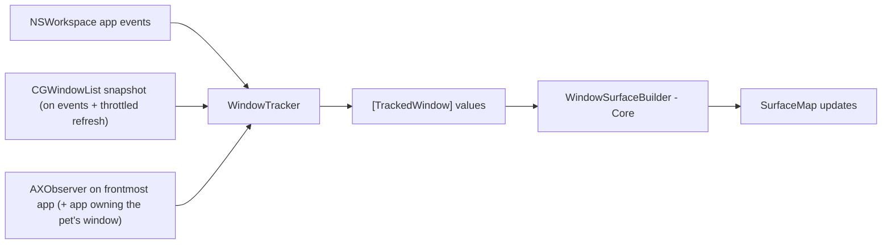

# Window Tracking (M12–M13)

Not part of the MVP. This document defines contracts and the investigation plan so the MVP
architecture does not block it. Items marked **[validate]** need the M12 spike.

## Requirements recap

FR-27, FR-28: detect other apps' windows (position, size, z-order, moves, resizes, minimize, close,
focus changes) so pets can walk on window top edges and react. **Purely visual**: PetScape never
manipulates real windows. The feature is **opt-in**; the Accessibility permission is requested only
when the user enables it ([permissions.md](../specifications/permissions.md)).

## Public APIs available

| API | Gives | Permission | Limitations |
|---|---|---|---|
| `CGWindowListCopyWindowInfo(.optionOnScreenOnly, …)` | On-screen windows and front-to-back ordering. Apple's required-key list includes window number, owner PID, bounds, layer and alpha | Apple documents required keys, but does not specify their Accessibility/Screen Recording authorization behavior. Window-name keys are optional and are never read here. | Snapshot only; no change notifications; minimized windows disappear (not distinguishable from closed without AX) |
| `AXUIElement` (per app) + `AXObserver` | Window position/size attributes; notifications: `kAXWindowMovedNotification`, `kAXWindowResizedNotification`, `kAXUIElementDestroyedNotification`, `kAXWindowMiniaturizedNotification`, `kAXFocusedWindowChangedNotification` | Accessibility (user must grant in System Settings) | Synchronous IPC that can block on hung apps (bound with `AXUIElementSetMessagingTimeout`); some apps expose incomplete AX trees; move notifications may be coalesced during drags **[validate]** |
| `NSWorkspace` notifications | App launch/terminate/activate/hide/unhide | None | App-level only |
| ScreenCaptureKit `SCShareableContent` | Windows with metadata | Screen Recording | Rejected: heavier permission than needed, privacy-sensitive |

Important limitation: there is **no public API to map an `AXUIElement` window to its `CGWindowID`**
(the commonly used `_AXUIElementGetWindow` is private and therefore forbidden). Correlation must use
owner PID + frame matching (with tolerance), re-validated on each change.

## Proposed strategy (to confirm in the M12 spike)



1. **Enumeration and z-order:** `CGWindowList` snapshot, filtered (layer 0, alpha > 0, not our PID,
   min size, on a known screen). Refreshed on app/workspace events and at a low rate (≈1–2 Hz) only
   while the feature is enabled and the simulation is running.
2. **Low-latency updates** for the window a pet is standing on (and the frontmost app): AX observers
   for move/resize/destroy/minimize. If notifications prove coalesced during drags, poll that single
   window's `kAXPositionAttribute`/`kAXSizeAttribute` at the frame rate *only while a pet is attached
   to it* **[validate cost]**.
3. **Without Accessibility granted**, a degraded mode may still be possible using CGWindowList alone
   (bounds without permission) at a throttled rate — pets could walk on static windows but react
   late to moves. Whether to ship this mode is an open decision after the spike.

## Contracts (Core-facing values)

```swift
// Conceptual — not production code.
struct TrackedWindow: Sendable, Equatable {
    let id: TrackedWindowID          // CGWindowID when known; stable per window lifetime
    let ownerPID: pid_t
    let frame: CGRect                // canonical global space (AppKit, y-up)
    let zIndex: Int                  // 0 = frontmost
    let isMinimized: Bool
}

protocol WindowTracker: AnyObject {            // Platform, @MainActor
    var isAvailable: Bool { get }              // permission + feature flag
    func start(onChange: @escaping @MainActor ([TrackedWindow]) -> Void)
    func stop()
    func setHighFrequencyFocus(_ id: TrackedWindowID?) // the window a pet rides
}
```

`WindowSurfaceBuilder` (Core, pure) converts `[TrackedWindow]` + screens into `Surface`s:
the **visible portions** of each window's top edge (subtract segments covered by windows above it
in z-order), excluding segments under the menu bar or off-screen. Surface IDs derive from the
window ID so attached pets survive moves.

## Edge cases

| Case | Handling |
|---|---|
| Window partially off-screen | Clip surface to screen frames |
| Overlapping windows | Visible-portion computation; pet on a covered segment detaches (falls) |
| Window moved to another display | Surface moves; pet rides (cross-overlay rendering in M14) |
| Minimize / close / app quit / hide | Surface removed → attached pets fall |
| Fullscreen app enters | Overlay absent on that Space; tracker ignores that Space's windows |
| App with unusual windows (no AX, custom shapes) | Use CGWindowList bounds; accept imperfect tops |
| Unresponsive app | AX messaging timeout; mark window stale, keep last frame, retry later |
| Permission revoked while running | Detect via `AXIsProcessTrusted()` on activation; disable feature, notify in menu |

## Performance budget

Window tracking must add **≤ 1% CPU** on average while enabled and idle, and must be fully stopped
when the feature is disabled, the app is paused/hidden, or the system is suspended.

## M12 spike findings (2026-10-22)

### Apple API documentation

- `CGWindowListCopyWindowInfo` returns window dictionaries; `.optionOnScreenOnly` orders entries front-to-back. The required-key reference lists window number, owner PID, bounds, layer and alpha. The API reference warns that generating window dictionaries is relatively expensive, so callers must profile and limit use. It does not specify a permission matrix for the required fields. [CGWindowListCopyWindowInfo](https://developer.apple.com/documentation/coregraphics/cgwindowlistcopywindowinfo%28_%3A_%3A%29), [required keys](https://developer.apple.com/documentation/coregraphics/required-window-list-keys?language=objc), [on-screen ordering](https://developer.apple.com/documentation/coregraphics/cgwindowlistoption/optiononscreenonly).
- `AXIsProcessTrustedWithOptions` checks trust; its prompt option asynchronously informs the user. `AXUIElementSetMessagingTimeout` sets a per-element timeout (or a global timeout when passed the system-wide element). It does not provide a hard real-time guarantee for UI responsiveness. [trust check](https://developer.apple.com/documentation/applicationservices/1459186-axisprocesstrustedwithoptions), [timeout](https://developer.apple.com/documentation/applicationservices/1459345-axuielementsetmessagingtimeout).
- AX observer registration may fail for unsupported notifications or unresponsive apps; treat registration and delivery as best-effort. [AXObserverAddNotification](https://developer.apple.com/documentation/applicationservices/1462089-axobserveraddnotification).

### Measured observations

The owner granted Accessibility on 2026-10-22 and the opted-in Debug app accepted the grant after a fresh launch. Short native CPU samples were collected while the pet remained active: with tracking disabled, five one-second `top` samples on 2026-10-22 were 0.0–1.5% (mean 1.1%); with tracking enabled, ten samples on 2026-10-22 were 0.0–3.2% (mean 2.2%), ten samples on 2026-10-23 were 0.0–3.4% (mean 2.34%), and a further ten samples on 2026-10-23 were 0.0–3.5% (mean 1.81%). These do not isolate tracking overhead because the pet was active and the runs were brief; they do not establish the ≤1% idle target. An on-screen window inventory on 2026-10-23 saw 14 eligible windows across 14 external app owners, meeting the count threshold but not the named app matrix or accuracy check. It did not compare tracked surfaces to AX frames. No DEBUG surface visualization, drag cadence, timeout, or revocation experiment was completed. Those remain manual gates; no measurement is inferred from API documentation.

### Implementation findings and inference

- The adapter reads only required identity/geometry/order fields and never accesses optional owner-name or window-name keys. It filters the current process, nonzero normal layers, transparent/invalid/tiny frames, and frames outside known screens. Quartz-to-canonical conversion uses `CoordinateConverter`'s primary-screen height, including negative secondary-screen origins.
- PID plus geometric frame matching is an inference, not a documented AX-to-CG identity mapping. It can be ambiguous for same-process overlapping windows and must be revalidated after every relevant notification/snapshot. Private `_AXUIElementGetWindow` is prohibited.
- A throttled CG-only mode could provide stale positions between snapshots, but its movement lag, cost and cross-version behavior were not measured. D-11 was decided by the owner on 2026-10-22: Accessibility is required, and CG-only tracking is not offered.
- AX notifications, including move/resize, have not been proven continuous during native drags. Until measured, they cannot replace a bounded refresh of the CG snapshot. Calls that may block must not run on the UI path without an approved concurrency design.
- Current implementation gives AX elements a 0.25 s messaging timeout and performs initial focused-window registration/attribute reads from the main-run-loop observer path. This bounds each call but can still cause a perceptible stall; native hang/latency testing is required before treating T12.4 as validated. No new worker-thread model was introduced.

### Limitations / remaining spike work

Native tests still required: availability of geometry fields on this OS without Screen Recording; AX event cadence while dragging; AX/CG correlation and ambiguity on the ten named app classes; timeout behavior on an intentionally unresponsive target; repeatable Instruments CPU measurements. Do not log window titles, app names, or frame histories.
