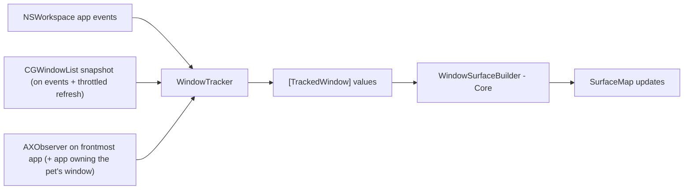

# Window Tracking (M12–M13)

Not part of the MVP. This document defines contracts and the investigation plan so the MVP
architecture does not block it. Items marked **[validate]** need the M12 spike.

## Requirements recap

FR-27, FR-28: detect other apps' windows (position, size, z-order, moves, resizes, minimize, close,
focus changes) so pets can walk on window top edges and react. **Purely visual**: PetScape never
manipulates real windows. The feature is **opt-in**; the Accessibility permission is requested only
when the user enables it ([permissions.md](../specifications/permissions.md)).

## Public APIs available

| API | Gives | Permission | Limitations |
|---|---|---|---|
| `CGWindowListCopyWindowInfo(.optionOnScreenOnly, …)` | All on-screen windows: `kCGWindowNumber`, owner PID, bounds (Quartz global), layer, alpha, front-to-back order | Bounds/PID/layer expected **without** permission; window *names* require Screen Recording (not needed) **[validate on macOS 27]** | Snapshot only (polling); no change notifications; minimized windows disappear (not distinguishable from closed without AX) |
| `AXUIElement` (per app) + `AXObserver` | Window position/size attributes; notifications: `kAXWindowMovedNotification`, `kAXWindowResizedNotification`, `kAXUIElementDestroyedNotification`, `kAXWindowMiniaturizedNotification`, `kAXFocusedWindowChangedNotification` | Accessibility (user must grant in System Settings) | Synchronous IPC that can block on hung apps (bound with `AXUIElementSetMessagingTimeout`); some apps expose incomplete AX trees; move notifications may be coalesced during drags **[validate]** |
| `NSWorkspace` notifications | App launch/terminate/activate/hide/unhide | None | App-level only |
| ScreenCaptureKit `SCShareableContent` | Windows with metadata | Screen Recording | Rejected: heavier permission than needed, privacy-sensitive |

Important limitation: there is **no public API to map an `AXUIElement` window to its `CGWindowID`**
(the commonly used `_AXUIElementGetWindow` is private and therefore forbidden). Correlation must use
owner PID + frame matching (with tolerance), re-validated on each change.

## Proposed strategy (to confirm in the M12 spike)



1. **Enumeration and z-order:** `CGWindowList` snapshot, filtered (layer 0, alpha > 0, not our PID,
   min size, on a known screen). Refreshed on app/workspace events and at a low rate (≈1–2 Hz) only
   while the feature is enabled and the simulation is running.
2. **Low-latency updates** for the window a pet is standing on (and the frontmost app): AX observers
   for move/resize/destroy/minimize. If notifications prove coalesced during drags, poll that single
   window's `kAXPositionAttribute`/`kAXSizeAttribute` at the frame rate *only while a pet is attached
   to it* **[validate cost]**.
3. **Without Accessibility granted**, a degraded mode may still be possible using CGWindowList alone
   (bounds without permission) at a throttled rate — pets could walk on static windows but react
   late to moves. Whether to ship this mode is an open decision after the spike.

## Contracts (Core-facing values)

```swift
// Conceptual — not production code.
struct TrackedWindow: Sendable, Equatable {
    let id: TrackedWindowID          // CGWindowID when known; stable per window lifetime
    let ownerPID: pid_t
    let frame: CGRect                // canonical global space (AppKit, y-up)
    let zIndex: Int                  // 0 = frontmost
    let isMinimized: Bool
}

protocol WindowTracker: AnyObject {            // Platform, @MainActor
    var isAvailable: Bool { get }              // permission + feature flag
    func start(onChange: @escaping @MainActor ([TrackedWindow]) -> Void)
    func stop()
    func setHighFrequencyFocus(_ id: TrackedWindowID?) // the window a pet rides
}
```

`WindowSurfaceBuilder` (Core, pure) converts `[TrackedWindow]` + screens into `Surface`s:
the **visible portions** of each window's top edge (subtract segments covered by windows above it
in z-order), excluding segments under the menu bar or off-screen. Surface IDs derive from the
window ID so attached pets survive moves.

## Edge cases

| Case | Handling |
|---|---|
| Window partially off-screen | Clip surface to screen frames |
| Overlapping windows | Visible-portion computation; pet on a covered segment detaches (falls) |
| Window moved to another display | Surface moves; pet rides (cross-overlay rendering in M14) |
| Minimize / close / app quit / hide | Surface removed → attached pets fall |
| Fullscreen app enters | Overlay absent on that Space; tracker ignores that Space's windows |
| App with unusual windows (no AX, custom shapes) | Use CGWindowList bounds; accept imperfect tops |
| Unresponsive app | AX messaging timeout; mark window stale, keep last frame, retry later |
| Permission revoked while running | Detect via `AXIsProcessTrusted()` on activation; disable feature, notify in menu |

## Performance budget

Window tracking must add **< 1% CPU** on average while enabled and idle, and must be fully stopped
when the feature is disabled, the app is paused/hidden, or the system is suspended.
