# Release & Distribution Strategy

Not implemented in this phase (CI/CD is planned for M2 basic checks and M20 releases).
Decision: [ADR-0010](../decisions/0010-distribution-no-sandbox.md).

## Channel

GitHub Releases only (no Mac App Store). Artifacts: notarized, stapled DMG containing `PetScape.app`
(+ SHA-256 checksum in the release notes). No auto-update in v1 (an updater such as Sparkle would add
a dependency and network access; revisit after v1.0 with an ADR).

## Versioning

- Semantic Versioning: `MAJOR.MINOR.PATCH`; pre-1.0 minors may break preferences (with migration).
- `MARKETING_VERSION` = SemVer; `CURRENT_PROJECT_VERSION` = monotonically increasing build number.
- Tags `vX.Y.Z` on `main`; release branch merges from `develop`.
- `CHANGELOG.md` following Keep a Changelog, updated in each PR that changes user-visible behavior
  (created in T20.2; until then, PR descriptions carry the notes).

## Build and signing pipeline (M20)

```mermaid
flowchart LR
  Tag[git tag vX.Y.Z] --> CI[GitHub Actions macOS runner]
  CI --> Test[make lint + make test]
  Test --> Archive[xcodebuild archive - Release]
  Archive --> Export[exportArchive - Developer ID]
  Export --> Notarize1[notarytool submit app zip --wait]
  Notarize1 --> Staple1[stapler staple app]
  Staple1 --> DMG[hdiutil create DMG + codesign DMG]
  DMG --> Notarize2[notarytool submit DMG --wait + staple]
  Notarize2 --> Verify[spctl --assess + codesign --verify --deep --strict]
  Verify --> Publish[gh release create with DMG + checksum]
```

| Item | Plan |
|---|---|
| Hardened Runtime | On; no exception entitlements |
| App Sandbox | Off (ADR-0010) |
| Signing identity | "Developer ID Application" certificate (requires Apple Developer Program) |
| Notarization credentials | App Store Connect API key (`.p8`) stored as GitHub encrypted secrets; imported into a temporary keychain per run; never committed |
| Runner | GitHub-hosted macOS runner with Xcode ≥ 26 (code stays Swift 6.2-compatible) |
| Reproducibility | Release script runnable locally (`scripts/release.sh`) with the same steps as CI |
| Pre-Developer-ID fallback | Ad-hoc signed zip marked "pre-release" with "Open Anyway" instructions |

## CI for development (M2, if approved — D-06)

On push/PR to `develop`: checkout → select Xcode → `make lint` → `make test-core` → `make build`.
UI tests run locally until they prove stable on CI.

## Implications summary

| Topic | Implication |
|---|---|
| Accessibility API | Works only unsandboxed; grants tied to the signing identity — keep the identity stable across releases |
| Hardened Runtime | Required for notarization; no JIT/unsigned memory needed |
| Notarization | Requires Apple Developer Program; adds ~minutes per release |
| Bundle ID | Must be final before the first public release (changing it resets prefs and grants) |
| Mac App Store | Not compatible with the window-interaction features (sandbox) |
