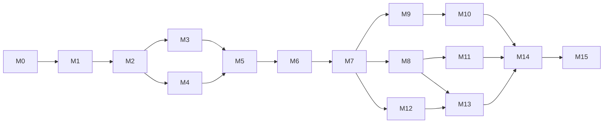

# Implementation Plan

Companion documents: [milestones.md](milestones.md) (what and status),
[task-breakdown.md](task-breakdown.md) (how, task by task),
[acceptance-criteria.md](acceptance-criteria.md) (done means),
[proof-of-concept.md](proof-of-concept.md), [risks.md](risks.md).

## Strategy

1. **Risk first.** The riskiest assumptions are platform behaviors (transparent overlay,
   click-through, Dock placement, energy). A throwaway PoC (M1) validates them before the
   architecture is committed in code.
2. **Vertical slices.** Each milestone ends with something runnable and demonstrable.
3. **Pure core, thin edges.** Logic goes to `PetScapeCore` with tests first; platform adapters stay
   thin and are verified by running the app and the manual matrix.
4. **Data before code for art.** Animations are added via character packs; missing art uses
   fallbacks so engineering never waits for assets.
5. **Measure, don't assume.** Performance targets are measured at the end of M1, M6 and M14.

## Changes from the initially proposed sequence

| Proposed | Planned | Why |
|---|---|---|
| M1 app → M2 overlay → M3 render cat | **M1 = PoC spike** covering overlay + render + click-through + Dock + interaction + resolutions | Validates the riskiest assumptions in days, before structuring code around them |
| M3 render + M4 animation system separate | **M4 animation system** (data + timing + textures), then **M5 render + walk** | Rendering the real cat needs the pack loader; walking needs both |
| M6 Dock integration last of MVP | **M6 Dock + MVP hardening** (sleep/wake, screen changes, errors, perf) | MVP quality items belong before release v0.1.0 |
| Settings unscheduled | Settings v1 in **M9** with behaviors | Settings are mostly behavior toggles |
| Climbing (M11) before window detection (M12) | Kept, but M12 depends only on M7 and can run in parallel with M8–M11 | Reduces critical path |
| Optimization (M14) as last | **M14** multi-display + stabilization, **M15** release pipeline | Distribution is its own concern |

## Phases and dependencies

Critical path to MVP: M0 → M1 → M2 → (M3 ∥ M4) → M5 → M6.

Parallelizable inside the MVP: M4's pure tasks (T4.1–T4.5) do not depend on M3 and can be done by
another agent/session while M3 proceeds (different modules, different files).

## Working agreement (humans and agents)

- One task = one branch = one PR into `develop`, named `feature/T<id>-<slug>`; PoC uses
  `spike/overlay-poc` and is **not merged** (only its findings are).
- A task is started only when its prerequisites are done and the owner asked for it.
- Each PR description lists: task ID, changes, tests run (with output summary), manual checks,
  limitations, follow-ups, and updated docs.
- `develop` must always build and pass tests. `main` receives release merges/tags only.
- Commits only when asked; Conventional Commits (`feat:`, `fix:`, `docs:`, `test:`, `refactor:`, `chore:`).
- Status updates go in the milestone table ([milestones.md](milestones.md)).

## Effort (rough, to calibrate after M1)

Sizes: **S** ≤ ½ day, **M** ≤ 1 day, **L** ≤ 2 days (anything bigger must be split).

| Milestone | Tasks | Rough size |
|---|---|---|
| M1 PoC | 9 | 2–3 days (timeboxed) |
| M2–M6 MVP | ~45 | 3–4 weeks part-time |
| M7–M11 | ~35 | 4–6 weeks + art |
| M12–M13 | ~14 | 2–3 weeks |
| M14–M15 | ~14 | 2–3 weeks |

## First recommended task

1. **T0.5** — owner reviews this plan and answers the open decisions in [risks.md](risks.md)
   (at minimum D-01 license, D-02 docs language, D-05 approval of the PoC).
2. **T1.1** — create the PoC spike project on `spike/overlay-poc` and run experiments E1–E2 first
   (overlay + click-through), since every later decision depends on them.
