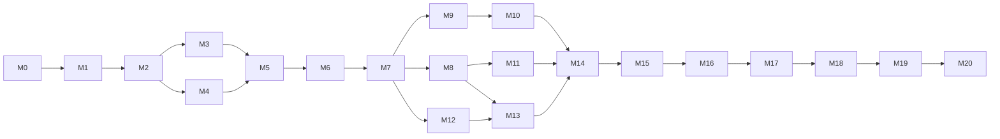

# Implementation Plan

Companion documents: [milestones.md](milestones.md) (what and status),
[task-breakdown.md](task-breakdown.md) (how, task by task),
[acceptance-criteria.md](acceptance-criteria.md) (done means),
[proof-of-concept.md](proof-of-concept.md), [risks.md](risks.md).

## Strategy

1. **Risk first.** The riskiest assumptions are platform behaviors (transparent overlay,
   click-through, Dock placement, energy). A throwaway PoC (M1) validates them before the
   architecture is committed in code.
2. **Vertical slices.** Each milestone ends with something runnable and demonstrable.
3. **Pure core, thin edges.** Logic goes to `PetScapeCore` with tests first; platform adapters stay
   thin and are verified by running the app and the manual matrix.
4. **Data before code for art.** Animations are added via character packs; missing art uses
   fallbacks so engineering never waits for assets.
5. **Measure, don't assume.** Performance targets are measured at the end of M1, M6 and M14.

## Changes from the initially proposed sequence

| Proposed | Planned | Why |
|---|---|---|
| M1 app → M2 overlay → M3 render cat | **M1 = PoC spike** covering overlay + render + click-through + Dock + interaction + resolutions | Validates the riskiest assumptions in days, before structuring code around them |
| M3 render + M4 animation system separate | **M4 animation system** (data + timing + textures), then **M5 render + walk** | Rendering the real cat needs the pack loader; walking needs both |
| M6 Dock integration last of MVP | **M6 Dock + MVP hardening** (sleep/wake, screen changes, errors, perf) | MVP quality items belong before release v0.1.0 |
| Settings unscheduled | Settings v1 in **M9** with behaviors | Settings are mostly behavior toggles |
| Climbing (M11) before window detection (M12) | Kept, but M12 depends only on M7 and can run in parallel with M8–M11 | Reduces critical path |
| Optimization and distribution sequence | **M14** multi-display + stabilization, **M15** animation quality, **M16** new behaviors/art, **M17** localization, **M18** bundled character selection, **M19** pack discovery/installation, **M20** release pipeline | Product work precedes distribution |

## Phases and dependencies

Critical path to MVP: M0 → M1 → M2 → (M3 ∥ M4) → M5 → M6.

Parallelizable inside the MVP: M4's pure tasks (T4.1–T4.5) do not depend on M3 and can be done by
another agent/session while M3 proceeds (different modules, different files).

## Working agreement (humans and agents)

- One task = one branch = one PR into `develop`, named `feature/T<id>-<slug>`; PoC uses
  `spike/overlay-poc` and is **not merged** (only its findings are).
- A task is started only when its prerequisites are done and the owner asked for it.
- Each PR description lists: task ID, changes, tests run (with output summary), manual checks,
  limitations, follow-ups, and updated docs.
- `develop` must always build and pass tests. `main` receives release merges/tags only.
- Commits only when asked; Conventional Commits (`feat:`, `fix:`, `docs:`, `test:`, `refactor:`, `chore:`).
- Status updates go in the milestone table ([milestones.md](milestones.md)).

## Effort (rough, to calibrate after M1)

Sizes: **S** ≤ ½ day, **M** ≤ 1 day, **L** ≤ 2 days (anything bigger must be split).

| Milestone | Tasks | Rough size |
|---|---|---|
| M1 PoC | 9 | 2–3 days (timeboxed) |
| M2–M6 MVP | ~45 | 3–4 weeks part-time |
| M7–M11 | ~35 | 4–6 weeks + art |
| M12–M13 | ~14 | 2–3 weeks |
| M14–M20 | Scope and estimates to be planned per milestone |

## M7/M8 planning revision (2026-10-18)

Status: **M7/M8 Done by explicit owner acceptance, 2026-10-18.** This section retains the
M7/M8 sequencing history; M9 was subsequently reauthorized under its [implementation plan](m9-implementation.md).
Brief, code diagnosis, D1–D10 compatibility and
approval questions: [technical review](m7-m8-technical-review.md). Detailed executable plans remain
in [task-breakdown.md](task-breakdown.md#m7--basic-physics), not a duplicate plan tree.
Specs: [Physics](../architecture/physics-engine.md), [Jumps](../architecture/jump-system.md),
[V4 art](../specifications/animation-assets-v4.md), [M9 boundaries](../architecture/behavior-engine.md).

1. Owner reviews ADR-0016–0018 and the blocked literal SpriteKit clause; retaining Core Animation
   is the smallest correction to match accepted ADR-0015. Review simulation-owned launch/landing,
   stricter dt API, logical geometry, persistent floor and no automatic lift when Dock reappears.
2. Close [M5/M6 evidence](m5-m6-closeout.md) and accept remaining deviations. Planning proceeds
   independently. Default M7 implementation gate is M6 acceptance; owner may explicitly authorize
   pure T7.1/T7.2 before closeout with named gaps. Runtime adoption T7.4 needs baseline non-interference,
   environment and CPU evidence or explicit named exceptions, not an inferred waiver.
3. First requested implementation should be **T7.1** (values/integration/tests; no live behavior change),
   followed by T7.2 sweep, T7.3 floor composition, T7.4 world/flight, T7.5 walking policy,
   T7.6 liveness/demand, T7.7 recovery/environment and T7.8 acceptance/performance.
4. Freeze verified M7 contracts and obtain owner milestone acceptance. M8 may then implement
   T8.1 solver → T8.2 execution → T8.3 target safety → T8.4 animation causality.
5. V4 production is separately authorized, can overlap engineering, and never blocks M7.
   T8.5 integrates delivered art and measures proposed ≤16 MiB image budget (vs MVP 10 MB);
   T8.6 closes regression/performance/owner review. Logical M8 may use fallbacks; full visual
   completion needs art or an explicit owner-approved deferral, not an automatic pass.
6. M9 is prepared architecturally only. No autonomous selector/needs/personality/Settings code
   is included; its own request/design gate follows accepted M7/M8 contracts.

Every task includes dependencies, real/proposed files, interfaces, red/green tests, acceptance,
risks and DoD. All slices stay buildable; no commits, pushes, tags or PRs without explicit request.
M5/M6 initially stayed In review; the owner subsequently explicitly closed M2/M3/M5/M6. Subsequent owner instruction explicitly authorized all M7/M8 tasks
continuously, including runtime engineering before manual closeout. The owner subsequently
confirmed all remaining M7/M8 tests and explicitly requested closure: both are Done.
[Closeout](m7-m8-technical-review.md#owner-m7m8-closeout-2026-10-18) preserves missing numeric
evidence without claiming new measurements. V4 is integrated, measured and visually approved.
M9 was temporarily deferred, then explicitly reauthorized for continuous implementation.
Current scope and evidence are recorded in [m9-implementation.md](m9-implementation.md).

## Historical first steps (2026-10-16, completed planning/PoC)

The initial recommendation was T0.5 owner planning review, then T1.1 PoC on spike/overlay-poc.
The PoC is now Done; those steps are retained as history, not the next implementation action.

## M10 planning revision (2026-10-18)

M10 remains **Not started**; owner requested documentation only. Read the
[M10 task plan](m10-implementation.md), [native PoC gate](m10-native-poc.md),
[interaction contracts](../specifications/interaction.md) and Proposed ADR-0019–0021.
Recommended first implementation task is **T10.0**, only after explicit authorization.
A prototype result and owner-approved routing topology precede production input changes.
Awareness/direct/drag engineering reuses Core Animation, one PetWorld and existing physics/HSM.
Throwing, chase/approach/startle and cross-display handoff are deferred in the first scope;
V5 curious/picked-up/held art requires separate authorization and optional fallbacks preserve
engineering independence. No code, test, asset, schema or dependency changes were made in planning.
