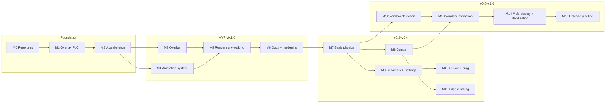

# Roadmap

High-level view. Detailed milestones live in [milestones.md](../planning/milestones.md); tasks in
[task-breakdown.md](../planning/task-breakdown.md).

| Release | Milestones | Theme |
|---|---|---|
| — | M0–M1 | Planning, risk validation |
| v0.1.0 | M2–M6 | MVP: cat walks on the Dock |
| v0.2.0 | M7–M8 | Physics: falls, jumps, landings |
| v0.3.0 | M9 | Autonomous life + Settings v1 |
| v0.4.0 | M10–M11 | Cursor, dragging, climbing |
| v0.5.0 | M12–M13 | Window-aware pets (opt-in Accessibility) |
| v1.0.0 | M14–M15 | Multi-display, stabilization, notarized releases |
| later | — | Multiple pets, pet interactions, more characters (FR-40..44) |

## Art dependencies

Engineering can progress with fallbacks, but the experience depends on new animations. Each clip
below should be delivered as a character-pack update (see
[asset-format.md](../specifications/asset-format.md)).

| Needed by | Clips |
|---|---|
| M6 (nice to have) | `idle` (breathing loop) |
| M7 | Optional `fall`/`landing` (legacy `land` compatible); current pack sufficient for physics |
| M8 | V4 `idle`, `jump-start` (requested label jump_start), `jump`, `fall`, `landing`; legacy jump-air/land compatible |
| M9 | `sit-down`, `sit` (loop), `lie-down`, `sleep` (loop), `wake-up`, `stretch`, `look-around` |
| M10 | Proposed V5 `curious`, `picked-up`, `held` art was not delivered; owner accepted safe existing fallbacks at M10 closeout. Extra look/startle/run/petting art deferred — [brief](../specifications/animation-assets-v5.md) |
| M11 | `climb` (loop, vertical alignment), `climb-over` (once) |

Until a clip exists, the manifest's fallback chain maps it to an existing clip (for example
`fall → walk`), so code never blocks on art.

## 2026-10-18 execution status

Owner approved planning and subsequently authorized continuous M7/M8 engineering. Physics, visible
falls/landings, explicit safe jumps and walk/idle return are implemented and **Done by owner acceptance**
(2026-10-18). That M7/M8 baseline used walking plus explicit DEBUG jumps. M9 was subsequently
reauthorized and adds default autonomous activity selection and persisted Settings. [Task evidence](../planning/task-breakdown.md#execution-evidence-2026-10-18) and
[technical review](../planning/m7-m8-technical-review.md) distinguish automated results from
manual/performance/owner acceptance. M2/M3/M5/M6 are closed by explicit owner acceptance; missing measurements remain evidence limits.

Core Animation remains the renderer (ADR-0015/0016). V4 uses additive schema v1, variable frame
counts and the approved design budget. V4 revision 1 is produced/integrated: 24 new frames,
10.125 MiB decoded images; original walk sources remain unchanged. The additive manifest retains
legacy aliases. [Production record](../../assets/characters/cat/v4/README.md) includes provenance,
QA and previews. Owner approved V4 and subsequently confirmed all remaining tests, explicitly
closing M7/M8. Missing instrumented readings/soak records remain evidence limits, as detailed in
the [owner closeout](../planning/m7-m8-technical-review.md#owner-m7m8-closeout-2026-10-18).
M9 is closed by owner acceptance under its [execution record](../planning/m9-implementation.md#owner-m9-closeout-2026-10-18); remaining real-login, native-cadence and installed-app playtest evidence gaps are explicit. Rest/expression
phases deliberately hold an idle fallback when dedicated art is absent. No commit, release or tag
is implied by engineering completion.

## M10 scope and closeout (2026-10-22)

[Technical plan](../planning/m10-implementation.md) was implemented under explicit owner
authorization and M10 was closed by owner acceptance on 2026-10-22. Delivery includes bounded cursor
awareness, click, pickup and zero-impulse drop on the current host display, with existing physics
and behavior. V5 production art was not delivered; the owner accepted the safe existing fallbacks
for this milestone, without visual approval of rejected candidates. Historical FR-24
approach/startle and FR-25 throwing remain deferred, not claimed complete. M14 retains actual
display-to-display handoff. No release or tag is implied by milestone acceptance.
