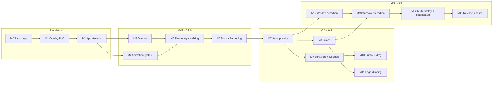

# Roadmap

High-level view. Detailed milestones live in [milestones.md](../planning/milestones.md); tasks in
[task-breakdown.md](../planning/task-breakdown.md).

| Release | Milestones | Theme |
|---|---|---|
| — | M0–M1 | Planning, risk validation |
| v0.1.0 | M2–M6 | MVP: cat walks on the Dock |
| v0.2.0 | M7–M8 | Physics: falls, jumps, landings |
| v0.3.0 | M9 | Autonomous life + Settings v1 |
| v0.4.0 | M10–M11 | Cursor, dragging, climbing |
| v0.5.0 | M12–M13 | Window-aware pets (opt-in Accessibility) |
| v1.0.0 | M14–M15 | Multi-display, stabilization, notarized releases |
| later | — | Multiple pets, pet interactions, more characters (FR-40..44) |

## Art dependencies

Engineering can progress with fallbacks, but the experience depends on new animations. Each clip
below should be delivered as a character-pack update (see
[asset-format.md](../specifications/asset-format.md)).

| Needed by | Clips |
|---|---|
| M6 (nice to have) | `idle` (breathing loop) |
| M7 | `fall` (loop), `land` (once) |
| M8 | `jump-start` (once), `jump-air` (loop), `land` |
| M9 | `sit-down`, `sit` (loop), `lie-down`, `sleep` (loop), `wake-up`, `stretch`, `look-around` |
| M10 | `look-up` / head-tracking variants, `startled`, `dangle` (dragged, loop), `run` |
| M11 | `climb` (loop, vertical alignment), `climb-over` (once) |

Until a clip exists, the manifest's fallback chain maps it to an existing clip (for example
`fall → walk`), so code never blocks on art.
