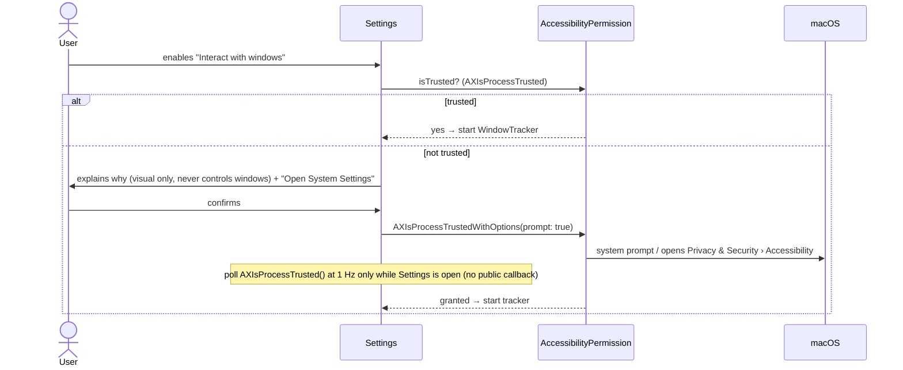

# Permissions

Principle: **ask for nothing until a feature that needs it is explicitly enabled by the user.**

## Matrix

| Capability | Permission | Needed by | Requested when | MVP |
|---|---|---|---|---|
| Overlay windows, Core Animation rendering | none | M2+ | — | ✅ none |
| Cursor position (`NSEvent.mouseLocation`) | none | M3+ | — | ✅ none |
| Global mouse-moved monitor | none (verified in PoC E2 on macOS 27.0.1) | M3+ (pass-through while paused) | — | ✅ none |
| Screen geometry, Dock estimate | none | M6 | — | ✅ none |
| Launch at login (`SMAppService.mainApp`) | user approval in System Settings › Login Items (system-managed) | M9 | user toggles "Launch at login" | — |
| Window positions via CGWindowList | none expected for bounds **[validate M12]** | M12 | — | — |
| Window change notifications via AX | **Accessibility** | M12–M13 | user enables "Interact with windows" | — |
| System output music classification | **System Audio Recording** (Core Audio tap, macOS 14.2+) | M16 | user confirms “Dance to music”; default off | — |
| Dock exact frame via AX (optional) | **Accessibility** | M12+ | same toggle | — |

Never requested (by design):

| Permission | Why not |
|---|---|
| Screen Recording | Window titles and screen contents are not needed (privacy, NFR-05) |
| Input Monitoring | No keyboard monitoring; mouse via public APIs that do not require it |
| Automation (Apple Events) | No control of other apps |
| Full Disk Access, Files & Folders | Only our bundle and Application Support are read |
| Notifications | Status is shown in the menu bar menu |
| Network | No network code at all |

## Accessibility flow (M12)

- Copy must state: PetScape only **reads** window positions to let pets walk on them; it never
  moves, clicks or reads the contents of windows.
- Revocation: check `AXIsProcessTrusted()` on app activation and when AX calls fail with
  `kAXErrorAPIDisabled`; stop the tracker and show "Window interaction paused — permission missing".
- Development note: Accessibility grants are tied to the code signature. Rebuilding with a
  different signature (e.g. ad-hoc vs Developer ID) may invalidate the grant; use a stable
  development signing identity (see [setup.md](../development/setup.md)).

## Sandbox and runtime implications

The M12 preference `petscape.windowInteraction` defaults off. Enabling it without Accessibility
trust first presents a confirmation explaining the read-only geometry use; only the affirmative
action invokes Apple's informational trust prompt and opens the Accessibility privacy pane. No
other permission is requested. The tracker and AX observers start only while the preference is enabled,
permission is trusted and `RunStatus` is running; see
[M12 progress](../planning/milestones.md#m12-window-detection).

- App Sandbox is **off** ([ADR-0010](../decisions/0010-distribution-no-sandbox.md)): sandboxed
  apps cannot use the AX API to observe other apps.
- Hardened Runtime is **on**. No exception entitlements are required (no JIT, no unsigned memory,
  no disabled library validation, no Apple Events).
- No `Info.plist` usage-description keys are needed for the MVP. Accessibility has no usage
  string; the system shows its own prompt.

## M10 proposed input boundary

[ADR-0019](../decisions/0019-cursor-observation.md) proposes current cursor reads, mouse-only
local/global movement monitoring and native view down/drag/up. No keyboard/event tap/AX/screen
capture or new permission request. Global monitors observe other apps asynchronously, local
monitors cover this app and return events unchanged. Native permission-free delivery is a
[M10.0 PoC gate](../planning/m10-native-poc.md), not assumed from API names alone. If a mouse
monitor cannot install, stop direct acquisition and retain frame-based awareness; do not ask for
Input Monitoring/Accessibility/Automation as a workaround. Store no cursor history; touched DEBUG
input logs must omit cursor coordinates. Existing M12 opt-in AX flow remains separate.

## M16 system audio consent and limits

[Music contract](../planning/m16-implementation.md): only a public Core Audio output tap, with
`NSAudioCaptureUsageDescription`. This is system audio consent, separate from forbidden Screen
Recording. No microphone permission, ScreenCaptureKit, Apple Events, process names/IDs, private
TCC API, network or disk recording is used. macOS 14.0–14.1 gets unavailable automatic mode and
permission-free manual dance. No permission request occurs merely by opening Settings.

The toggle first explains local system-output analysis. Confirming persists the new absent-default-off
`petscape.musicDancing` key and starts capture only with an active visible pet and autonomy enabled.
Pause/hide/sleep/lock/fullscreen suspension, no visible pet, autonomy off, opt-out and quit stop the
IOProc/tap/aggregate device, analysis stream/task, watchdog and output/format observers. Default
output or format changes stop safely and require an explicit off/on retry. Late callbacks have
both source and controller generation guards. Manual dance never starts the detector.

No public system-audio TCC status/preflight API is assumed. The visible monitoring state means
capture was requested, **not that consent was verified**. An OSStatus failure, analyzer error or
missing classification result for >5 s (checked every 2 s while active only) stops the source and
shows unavailable. A zero-filled stream can look like genuine silence; denied/revoked permission
cannot honestly be diagnosed from silence alone. Native denial/revocation behavior remains an
open verification item, including whether this OS terminates the process or stalls/silences the
stream. Do not claim immediate revocation detection, a passed native permission test, or an
unbounded-silence workaround. Confirm the access in macOS Privacy & Security and toggle off/on to
retry. A public-API solution that cannot satisfy native revocation requirements blocks final M16
acceptance; do not substitute a forbidden permission or private TCC call.

Audio lives only in bounded memory for analysis, is never saved/logged/transmitted, and no audio
or classification history persists. The callback copies at most 16,384 mono floats per packet;
the stream holds at most eight packets plus the analyzer's active window/internal work. Apple
SoundAnalysis can misclassify speech/TV/game audio; it detects acoustic music, not media-player
play/pause metadata. Short silence (<1 s of low-confidence observations) stays in the same session;
longer breaks and confidence errors can split or miss sessions. Headphone output is an intended
system-tap capability, not a native result claimed by this implementation.

### M16 owner follow-up: bundled consent text and first-session rearming

The owner's Spotify/YouTube failure report exposed a build integration defect: the prior
`INFOPLIST_KEY_NSAudioCaptureUsageDescription` setting was present in source but absent from both
built Debug and Release Info.plists. The app target now merges `Config/PetScape-Info.plist` into the
generated plist; `make build` validates the actual output key. This corrects the missing prerequisite
for Apple's consent flow without using another permission. Re-test with the newly built application;
no real permission grant or playback verification is claimed by this repair alone.

The restart latch now tracks confirmed music or an unresolved silence requirement, rather than
whether capture was merely attempted. Startup suspension/failed first start cannot suppress the
first detected song. Previously confirmed continuous playback still requires a stop/start across
suspension, preserving one dance per session. No audio, confidence history or content is logged.

## M16 owner acceptance — 2026-10-24

M16 is closed by explicit owner acceptance after the owner reported all behavior working.
The limits above remain evidence limits: no new revocation/route matrix, CPU/energy/leak, frame-
pacing or memory measurement is claimed, and no target or permission restriction is weakened.
See the [owner closeout](../planning/m16-implementation.md#owner-m16-closeout--2026-10-24).

### M17 localized permission copy

The Accessibility explanation, local system-audio consent copy and `NSAudioCaptureUsageDescription`
are translated in the app's `pt-BR` localization. English remains the source language. This changes
presentation only: permission defaults, triggers, APIs, retention and privacy boundaries above are
unchanged. Native system prompts use macOS's own language and were not replaced by app-authored UI.

## M19 user-selected character packs

Settings uses the native folder picker for a local pack chosen by the user. The app reads only that
selected folder for the duration of import, then copies the validated runtime manifest and referenced
PNG files into its own `~/Library/Application Support/PetScape/Characters` directory. No
security-scoped bookmark is persisted. Import and catalog discovery require no Full Disk Access,
Files & Folders, Accessibility, Screen Recording, Input Monitoring, Automation, or network access.
No archive is opened and no pack code is executed. All other files and directories are ignored for
runtime purposes and are not copied; symlink, alias, special-file, path, format and resource limits
are enforced by the [M19 pack contract](asset-format.md#user-installed-packs-m19).
