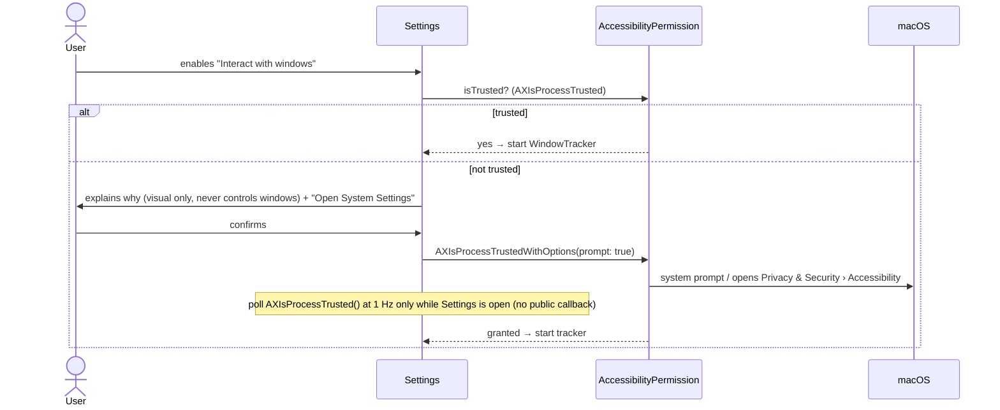

# Permissions

Principle: **ask for nothing until a feature that needs it is explicitly enabled by the user.**

## Matrix

| Capability | Permission | Needed by | Requested when | MVP |
|---|---|---|---|---|
| Overlay windows, Core Animation rendering | none | M2+ | — | ✅ none |
| Cursor position (`NSEvent.mouseLocation`) | none | M3+ | — | ✅ none |
| Global mouse-moved monitor | none (verified in PoC E2 on macOS 27.0.1) | M3+ (pass-through while paused) | — | ✅ none |
| Screen geometry, Dock estimate | none | M6 | — | ✅ none |
| Launch at login (`SMAppService.mainApp`) | user approval in System Settings › Login Items (system-managed) | M9 | user toggles "Launch at login" | — |
| Window positions via CGWindowList | none expected for bounds **[validate M12]** | M12 | — | — |
| Window change notifications via AX | **Accessibility** | M12–M13 | user enables "Interact with windows" | — |
| Dock exact frame via AX (optional) | **Accessibility** | M12+ | same toggle | — |

Never requested (by design):

| Permission | Why not |
|---|---|
| Screen Recording | Window titles and screen contents are not needed (privacy, NFR-05) |
| Input Monitoring | No keyboard monitoring; mouse via public APIs that do not require it |
| Automation (Apple Events) | No control of other apps |
| Full Disk Access, Files & Folders | Only our bundle and Application Support are read |
| Notifications | Status is shown in the menu bar menu |
| Network | No network code at all |

## Accessibility flow (M12)

- Copy must state: PetScape only **reads** window positions to let pets walk on them; it never
  moves, clicks or reads the contents of windows.
- Revocation: check `AXIsProcessTrusted()` on app activation and when AX calls fail with
  `kAXErrorAPIDisabled`; stop the tracker and show "Window interaction paused — permission missing".
- Development note: Accessibility grants are tied to the code signature. Rebuilding with a
  different signature (e.g. ad-hoc vs Developer ID) may invalidate the grant; use a stable
  development signing identity (see [setup.md](../development/setup.md)).

## Sandbox and runtime implications

- App Sandbox is **off** ([ADR-0010](../decisions/0010-distribution-no-sandbox.md)): sandboxed
  apps cannot use the AX API to observe other apps.
- Hardened Runtime is **on**. No exception entitlements are required (no JIT, no unsigned memory,
  no disabled library validation, no Apple Events).
- No `Info.plist` usage-description keys are needed for the MVP. Accessibility has no usage
  string; the system shows its own prompt.

## M10 proposed input boundary

[ADR-0019](../decisions/0019-cursor-observation.md) proposes current cursor reads, mouse-only
local/global movement monitoring and native view down/drag/up. No keyboard/event tap/AX/screen
capture or new permission request. Global monitors observe other apps asynchronously, local
monitors cover this app and return events unchanged. Native permission-free delivery is a
[M10.0 PoC gate](../planning/m10-native-poc.md), not assumed from API names alone. If a mouse
monitor cannot install, stop direct acquisition and retain frame-based awareness; do not ask for
Input Monitoring/Accessibility/Automation as a workaround. Store no cursor history; touched DEBUG
input logs must omit cursor coordinates. Existing M12 opt-in AX flow remains separate.
