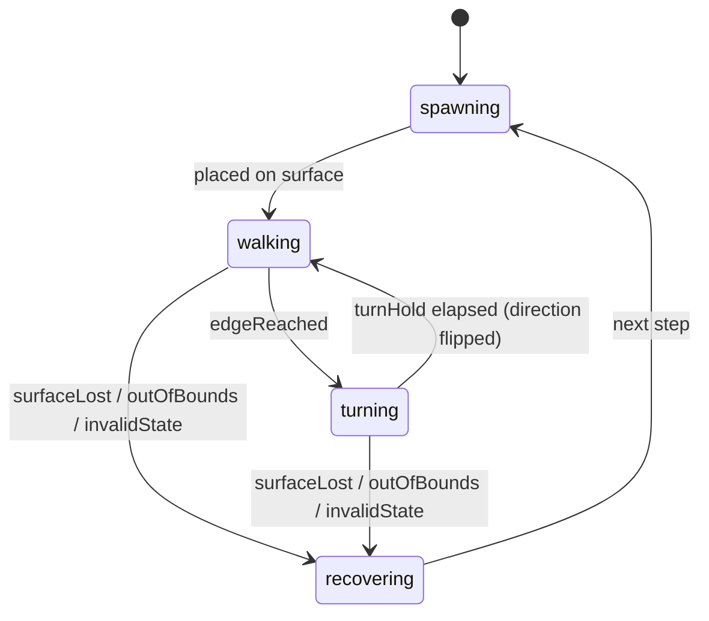

# State Machines

Design rationale: [behavior-engine.md](../architecture/behavior-engine.md). App-level run state
(running/paused/hidden/suspended): [data-flow.md](../architecture/data-flow.md#run-state).

## Conventions

- States are Swift enums with associated values; transitions are pure functions
  `(state, event, context) -> Transition` returning the next state plus effects
  (animation request, motion intent, emitted events).
- Every state declares: **clip**, **motion mode**, **interrupt threshold** (minimum event priority
  that may interrupt), **min/max duration**.
- Unhandled events are ignored (and counted in DEBUG); invalid combinations go to `recovering`.

## Event priorities

| Priority | Events |
|---|---|
| 100 | `grabbed`, `released(velocity)` (M10) |
| 90 | `surfaceLost`, `outOfBounds`, `invalidState` |
| 80 | `landed(surface)`, `edgeReached` |
| 50 | `cursorNear(point)`, `cursorFar`, `startled`, `petNear(id)` (future) |
| 10 | `activityChosen(activity)`, `timerElapsed`, `animationFinished` |

## Historical MVP pet state machine (M5–M6)

| State | Clip | Motion | Interrupt threshold | Duration |
|---|---|---|---|---|
| `spawning` | `walk` (frame 0) | none | 90 | 1 step |
| `walking(direction)` | `walk` (loop) | attached, speed = `nominalSpeed × speedScale` | 80 | until edge |
| `turning(to:)` | `walk` (paused on current frame) | none | 90 | `turnHold` = 0.15 s (tunable), then flip `facing` |
| `recovering(reason)` | — | none | — | 1 step; logs `recovered(reason)` |

Notes:

- `edgeReached` fires when the contact point is within `halfWidth` of the walkable segment's end
  (so the sprite never pokes past the edge).
- When the Dock surface changes size (user resizes Dock), the attachment parameter is re-projected;
  if the pet ends up outside the new segment it is clamped and `edgeReached` fires.
- `recovering(surfaceLost)` (Dock hidden, shown or moved to a side, M6): the pet re-settles on the new spawn
  surface at the same x (clamped into the walkable range), keeping facing and animation, when that surface
  spans its x; otherwise, and for every other reason, it respawns at a random position.
- App pause is not a pet state; the world is simply not stepped.

## Implemented M7/M8 hierarchy

Status: **Implemented; M7/M8 Done by owner acceptance (2026-10-18)**. Refines the existing PetState enum; RunState remains separate.
[Physics Engine](../architecture/physics-engine.md) owns contact/recovery;
[Jump System](../architecture/jump-system.md) owns the complete guarded transition table.
Historical target used JumpStart→Rising on an animation takeoff event and Landing→Idle on finished.
D8 / accepted ADR-0017 supersedes those planned triggers with simulation deadlines and physical events.

```mermaid
stateDiagram-v2
  [*] --> Spawning
  Spawning --> Grounded: placed
  state Grounded {
    Walking --> Turning: screen edgeReached
    Turning --> Walking: turnHold elapsed
    Walking --> PreparingJump: valid request (M8)
    Idle --> PreparingJump: valid request (M8)
    Landing --> Walking: settle timer / saved intent
    Landing --> Idle: settle timer / saved intent (M8)
  }
  state Airborne {
    Rising --> Falling: velocity sign crosses zero (M8)
  }
  PreparingJump --> Rising: simulation preparation deadline (M8)
  Grounded --> Falling: surfaceLost
  Airborne --> Landing: swept landed
  Grounded --> Recovering: invalid body / host removed
  Airborne --> Recovering: invalid / out of host / timeout
  Recovering --> Spawning: bounded placement attempt
  Spawning --> Spawning: no valid surface; wait for notification
```

These are locomotion phases, with saved activity intent (`walking`/`idle`) for M8 return, not a
second activity FSM. `spawning`/`recovering` stay lifecycle cases. Runtime paused/hidden/suspended
is an external permission gate: no step/timer advancement, overlay visibility is resolved separately.

| Phase | Milestone | Clip / fallback presentation | Motion / contact | Interrupt threshold | Min / max duration |
|---|---|---|---|---|---|
| Spawning | Existing | default frame, invisible until placed | no contact yet | 90 | one eligible step; waits without work if no surface |
| Walking | Existing/M7 | walk loop, rate tracks speed | grounded walk intent | 80 | until edge/request/support loss; no arbitrary timeout |
| Turning | Existing/M7 | held current walk frame | grounded hold | 90 | 0.15/0.15 s, then facing flip |
| Falling | M7 | fall; if absent held default frame | airborne gravity, attachment nil | 90 | physical contact; shared airborne max 3 s |
| Landing | M7, saved return in M8 | landing→legacy land→held default | grounded, zero velocity | 90 | 0.10/0.10 s; no art-finished dependency |
| Idle | M8 execution; autonomous selection M9 | idle loop; held default if absent | grounded hold | 10 | until request; M8 has no autonomous idle-duration choice |
| PreparingJump | M8 | jump-start once; held default if absent | grounded hold | 90 | 0.15/0.15 s, revalidate then impulse |
| Rising | M8 | jump→legacy jump-air→held default | airborne planned impulse, then gravity | 90 | sign crossing/contact; active plan≤2 s, shared watchdog 3 s |
| Recovering | Existing/M7 | invisible | no attachment/velocity; existing placement path | safety-only | at most one attempt per eligible step; wait if unavailable |

Priorities remain typed policy values; do not use frame-event strings as physical commands.
SurfaceLost/invalid-state priority 90 always wins over normal action selection or timer launch.
Contact/edge events are applied by world safety/phase handlers, not sent as low-priority requests to
noninterruptible art. Animation entry requests for physical phases use priority 90, then restore
normal priority on return to Walking/Idle. Duplicate requests/events cannot retrigger transitions.

Per-step invalid combinations recover deterministically. Airborne timeout never resets at apex;
missing clip/events cannot keep a pet in preparation/landing. No recursive transition loop:
reconcile safety, then at most one physical phase transition (apex/contact combined emits ordered
facts and ends Landing). Request rejection does not trigger another action-selection pass.

## M9 activity execution

M9 extends the same Grounded HSM; activity choice is separate from phase execution. Concrete
weights, energy/trait rules and cooldowns are in [Behavior Engine](../architecture/behavior-engine.md).
World defaults to explicit-command mode; production Runtime restores autonomous preferences.

| State / activity | Clip request (missing art holds idle fallback) | Motion | Interrupt threshold | Simulated duration / exit |
|---|---|---|---|---|
| Walk / Explore | walk | existing supported walking/edge turn | 80 | Walk 8–16 s, Explore 6–10 s; no progress 2 s → bounded Idle |
| Autonomous Idle | idle | grounded hold | 10 | 2–5 s; rejection/safety fallback 2 s |
| SittingDown | sit-down | grounded hold | 90 | 0.3 s → Sitting |
| Sitting | sit | grounded hold | 90 | 8–15 s → StandingUp |
| StandingUp | stand-up | grounded hold | 90 | 0.3 s → bounded Idle |
| LyingDown | lie-down | grounded hold | 90 | 0.3 s → Sleeping |
| Sleeping | sleep | grounded hold | 90 | 30–60 s → WakingUp; explicit wake allowed |
| WakingUp | wake-up | grounded hold | 90 | 0.5 s → bounded Idle |
| Stretching | stretch | grounded hold | 90 | 1.5 s → bounded Idle |
| Observing | observe | grounded hold; ambient look-around | 90 | 3–5 s → bounded Idle; cursor interaction remains M10 |
| ReactingToCursor | M10 | curious→idle fallback; idle under system Reduce Motion | grounded hold | 80 | bounded 1–3 s, restores saved activity with remaining duration |
| ReactingToClick | M10 | curious→idle fallback; idle under system Reduce Motion | grounded hold | 90 | 0.6 s, restores saved activity; 0.5 s repeat cooldown |
| Held | M10 | picked-up for 0.2 s, then held; each has idle fallback | world-owned cursor target, no attachment or gravity | critical | while primary is down; release immediately enters Falling |

Rest/expression semantic clips are optional. The current pack aliases all requests above to
existing idle; dedicated artwork is not claimed. Missing semantic clips hold the resolved frame,
independent of logical timers. These phase thresholds are safety/animation policy; explicit typed
wake/settings requests are validated by their world handlers. The shared grounded parent detects
lost support before ordinary selection and enters physical fall, even during rest or sleep.

One selection occurs at each eligible completion/deadline. Automatic Jump cooldown is eight
simulated seconds after completion/cancellation; sleep/stretch use twenty. Explicit M8 jump
cooldown remains separate. Paused/hidden/suspended time advances none of them. Disabling autonomy
midflight cancels only autonomous activity bookkeeping; gravity/contact continue unchanged and
cooldown is retained. Three consecutive selections exclude the same action when a valid alternative
exists; forced safety/critical-energy fallback and single-eligible-action cases remain bounded.

M10 adds Dragged and cursor-driven observation; M11 adds Climbing. Neither is implemented by M9.
Window surfaces/riding remain M12/M13. Future states must declare clip, motion, interrupt threshold
and bounds before implementation. Historical utility/top-k tuning remains superseded ADR-0006.

## Test obligations

- Every transition row has at least one unit test.
- Interrupt thresholds: a lower-priority event never interrupts; ≥ 90 always does.
- Deterministic scenarios with `SeededRandomSource` (e.g. "tired cat sleeps", "sleeping cat
  survives a Dock resize").
- Stuck detection: any state exceeding `maxDuration` transitions to `Idle`/`Recovering`.

## Proposed M10 refinements (not implemented)

The [interaction contract](interaction.md#state-priorities-and-resumption) defines press reservation,
held and finite cursor/click reaction states, exact motion/clip/interrupt/duration rules. Existing
Falling/Landing/Recovering are reused. Operational safety/RunState checks precede input, regardless
of historical grab=100 versus safety=90 presentation priority numbers. No throwing impulse in first
M10, no drag while paused; phase timers remain simulation-driven. These proposals require owner
approval and native routing evidence, [ADR-0021](../decisions/0021-interaction-authority-and-recovery.md).
