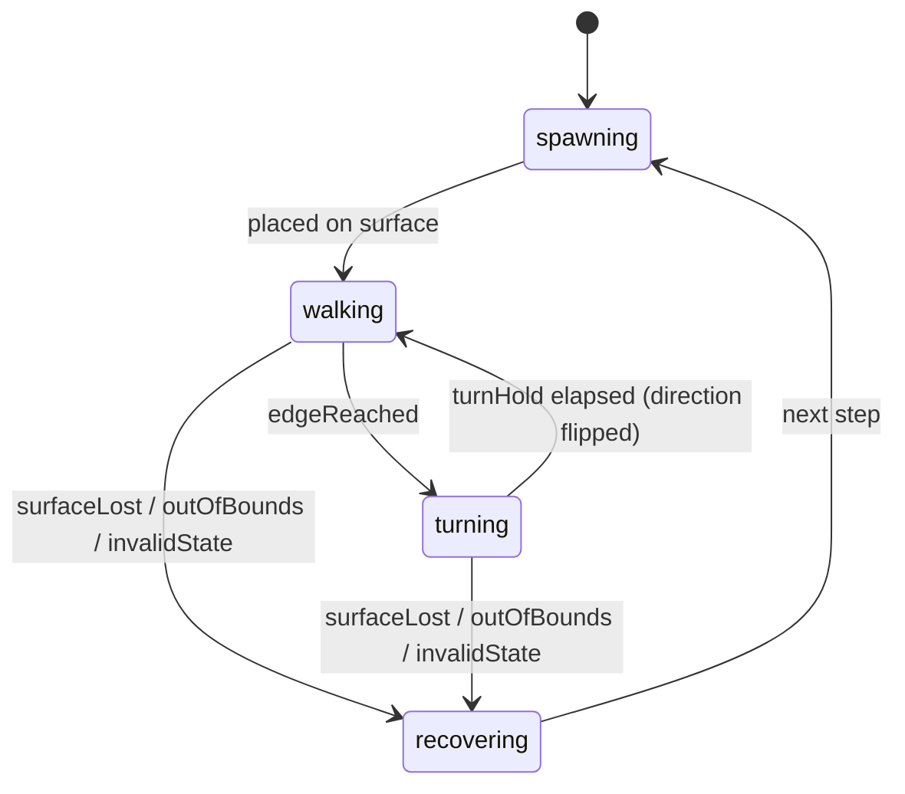
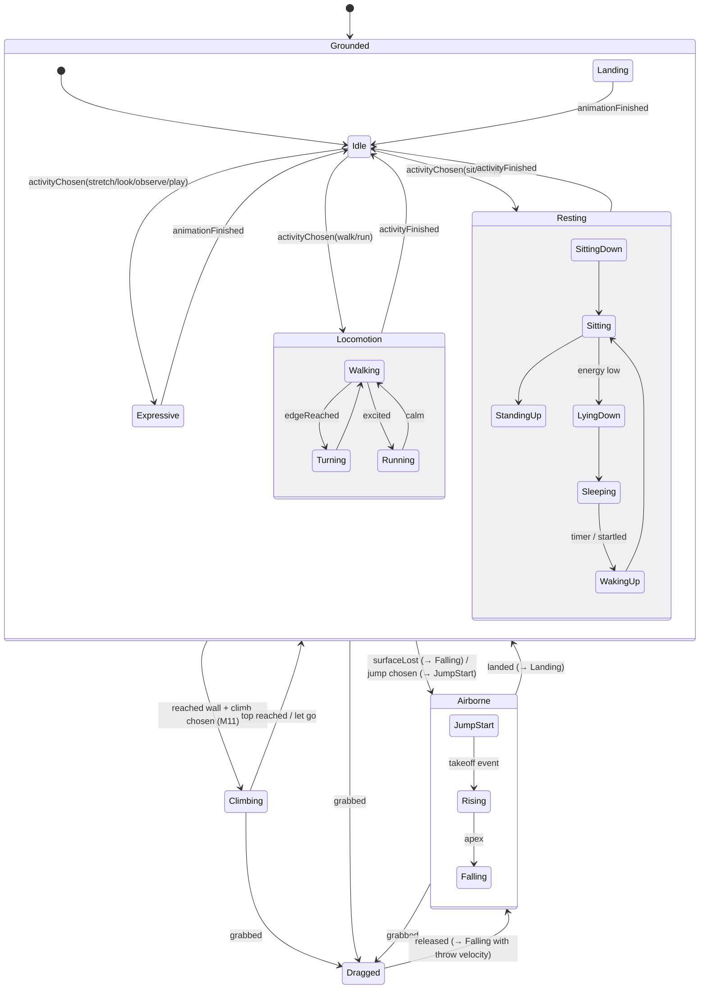

# State Machines

Design rationale: [behavior-engine.md](../architecture/behavior-engine.md). App-level run state
(running/paused/hidden/suspended): [data-flow.md](../architecture/data-flow.md#run-state).

## Conventions

- States are Swift enums with associated values; transitions are pure functions
  `(state, event, context) -> Transition` returning the next state plus effects
  (animation request, motion intent, emitted events).
- Every state declares: **clip**, **motion mode**, **interrupt threshold** (minimum event priority
  that may interrupt), **min/max duration**.
- Unhandled events are ignored (and counted in DEBUG); invalid combinations go to `recovering`.

## Event priorities

| Priority | Events |
|---|---|
| 100 | `grabbed`, `released(velocity)` (M10) |
| 90 | `surfaceLost`, `outOfBounds`, `invalidState` |
| 80 | `landed(surface)`, `edgeReached` |
| 50 | `cursorNear(point)`, `cursorFar`, `startled`, `petNear(id)` (future) |
| 10 | `activityChosen(activity)`, `timerElapsed`, `animationFinished` |

## MVP pet state machine (M5–M6)

| State | Clip | Motion | Interrupt threshold | Duration |
|---|---|---|---|---|
| `spawning` | `walk` (frame 0) | none | 90 | 1 step |
| `walking(direction)` | `walk` (loop) | attached, speed = `nominalSpeed × speedScale` | 80 | until edge |
| `turning(to:)` | `walk` (paused on current frame) | none | 90 | `turnHold` = 0.15 s (tunable), then flip `facing` |
| `recovering(reason)` | — | none | — | 1 step; logs `recovered(reason)` |

Notes:

- `edgeReached` fires when the contact point is within `halfWidth` of the walkable segment's end
  (so the sprite never pokes past the edge).
- When the Dock surface changes size (user resizes Dock), the attachment parameter is re-projected;
  if the pet ends up outside the new segment it is clamped and `edgeReached` fires.
- `recovering(surfaceLost)` (Dock hidden, shown or moved to a side, M6): the pet re-settles on the new spawn
  surface at the same x (clamped into the walkable range), keeping facing and animation, when that surface
  spans its x; otherwise, and for every other reason, it respawns at a random position.
- App pause is not a pet state; the world is simply not stepped.

## Target hierarchical state machine (M7+)

Parent-level handling (applies to all substates):

| Parent | Event | Target |
|---|---|---|
| Root | `grabbed` | `Dragged` |
| Root | `invalidState`, `outOfBounds` | `Recovering` → nearest surface |
| `Grounded` | `surfaceLost` | `Airborne.Falling` |
| `Grounded.Resting.Sleeping` | `startled` / `cursorNear` (priority 50) | `WakingUp` (only if `sleepDepth < threshold`) |
| `Airborne` | `landed` | `Grounded.Landing` |
| `Climbing` | `surfaceLost` | `Airborne.Falling` |

State catalogue (post-MVP), with fallbacks used until art exists:

| State | Clip (fallback) | Motion | Interrupt ≥ | Duration |
|---|---|---|---|---|
| `Idle` | `idle` (`walk` frame 0) | attached, speed 0 | 10 | 2–8 s |
| `Walking` | `walk` | attached | 50 | until edge/activity end |
| `Running` | `run` (`walk` at rate 1.8) | attached | 50 | 1–4 s |
| `SittingDown` / `Sitting` / `StandingUp` | `sit-down` / `sit` / `sit-down` reversed | attached, 0 | 90 / 50 / 90 | anim / 10–60 s / anim |
| `LyingDown` / `Sleeping` / `WakingUp` | `lie-down` / `sleep` / `wake-up` | attached, 0 | 90 / 50 / 90 | anim / 60–300 s / anim |
| `Stretching`, `LookingAround`, `Observing` | `stretch`, `look-around`, `observe` | attached, 0 | 50 | anim / 3–10 s |
| `JumpStart` / `Rising` / `Falling` | `jump-start` / `jump-air` / `fall` | none / airborne / airborne | 90 | anim / physics / physics |
| `Landing` | `land` | attached, 0 | 90 | anim |
| `ClimbingUp` / `ClimbingDown` / `ClimbOver` | `climb` / `climb` reversed / `climb-over` | climbing | 80 | physics / physics / anim |
| `Dragged` | `dangle` (`fall`) | dragged | 100 | until release |
| `Recovering` | — | none | — | 1 step |

## Cooldowns and probabilities (M9 initial values)

| Activity | Cooldown after end | Duration range | Notes |
|---|---|---|---|
| walk | 0 s | 5–20 s | default activity |
| run | 30 s | 1–4 s | more likely with high playfulness |
| sit | 20 s | 10–60 s | |
| sleep | 300 s | 60–300 s | only if energy < 0.35 |
| stretch | 120 s | animation | often after waking up |
| look-around | 15 s | 3–6 s | |
| observe cursor | 10 s | 3–10 s | needs cursor within 300 pt |

All values are data in a `BehaviorTuning` value and adjusted after playtesting.

## Test obligations

- Every transition row has at least one unit test.
- Interrupt thresholds: a lower-priority event never interrupts; ≥ 90 always does.
- Deterministic scenarios with `SeededRandomSource` (e.g. "tired cat sleeps", "sleeping cat
  survives a Dock resize").
- Stuck detection: any state exceeding `maxDuration` transitions to `Idle`/`Recovering`.
